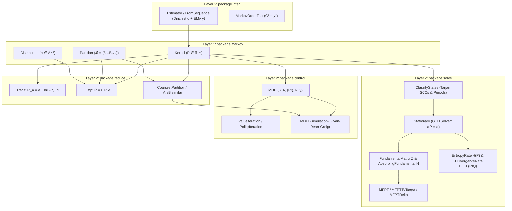

# `markov` Architecture & Mathematical Knowledge Graph

> **Generated from [`docs/surface/surface.jsonld`](./surface/surface.jsonld)** — Do not edit by hand; run `make docs-gen` (`go run ./tools/surface render`) to regenerate.

This document defines the complete public API surface, mathematical definitions, domain preconditions, boundary conditions, primary literature sources, and algebraic invariants across `github.com/stephen-mcelhose/markov`.

## Graph Predicate Schema

Each exported symbol node in [`docs/surface/surface.jsonld`](./surface/surface.jsonld) uses a fixed set of typed predicates validated by [`docs/surface/surface.shacl.ttl`](./surface/surface.shacl.ttl) and checked against the Go AST via `make surface-ast`:

* **`def:`** — Formal mathematical definition of the operator or object.
* **`req:`** — Domain preconditions required for the operator to be well-defined.
* **`err:`** — Explicit error or sentinel behavior when preconditions are violated.
* **`src:`** — Verifiable, open-access primary literature or reference implementation.
* **`⊢`** — Algebraic or probabilistic invariants that **MUST** hold within tolerance $\varepsilon = \text{tol}$.

## Package & Operator Architecture Graph



---

## Layer 1: Core Primitives (`package markov`)

Row-stochastic transition matrices (`Kernel`), probability simplex vectors (`Distribution`), and state-space equivalence classes (`Partition`).

### Mathematical Operator & Invariant Table

| Symbol & File | Definition (`def`) | Preconditions (`req`) & Errors (`err`) | Algebraic Invariants (`⊢`) & Sources (`src`) |
| :--- | :--- | :--- | :--- |
| **`NewKernel`**<br>`func NewKernel(P *mat.Dense, names []string) (*Kernel, error)`<br><sub>`kernel.go`</sub> | $P \in \mathbb{R}^{n \times n},\; P_{i,j} \ge -\varepsilon_0,\; \left\|\sum_{j=0}^{n-1} P_{i,j} - 1\right\| \le \varepsilon_0$ | **req:** $P \neq \text{nil}$, square $n \times n$ ($n \ge 1$), $\text{names} = \text{nil} \lor \|\text{names}\| = n$<br>**err:** Returns `ErrNotStochastic` on negative entries or row sums outside $1 \pm \varepsilon_0$ | ⊢ **Row Stochasticity:** $\forall i:\; P_{i,j} \ge -\varepsilon_0 \;\land\; \left\|\sum_j P_{i,j} - 1\right\| \le \varepsilon_0$<br>📄 [Kemeny & Snell (1976), *Finite Markov Chains*, Ch. I §1.1 (Full-Text PDF)](https://pku.edu.cn)<br>📄 [stephen-mcelhose/catrace (`trace.go`)](https://github.com/stephen-mcelhose/catrace) |
| **`NewKernelWithTol`**<br>`func NewKernelWithTol(P *mat.Dense, names []string, tol float64) (*Kernel, error)`<br><sub>`kernel.go`</sub> | $P \in \mathbb{R}^{n \times n},\; P_{i,j} \ge -\varepsilon,\; \left\|\sum_{j=0}^{n-1} P_{i,j} - 1\right\| \le \varepsilon$ | **req:** $P \neq \text{nil}$, square $n \times n$ ($n \ge 1$), $\varepsilon \ge 0$<br>**err:** Returns `ErrNotStochastic` if stochasticity fails beyond $\varepsilon$ | ⊢ **Tolerance Monotonicity:** $\varepsilon_1 \le \varepsilon_2 \implies \text{valid}(P, \varepsilon_1) \implies \text{valid}(P, \varepsilon_2)$<br>📄 [Kemeny & Snell (1976), *Finite Markov Chains*, Ch. I §1.1 (Full-Text PDF)](https://pku.edu.cn) |
| **`MustNewKernel`**<br>`func MustNewKernel(P *mat.Dense, names []string) *Kernel`<br><sub>`kernel.go`</sub> | $\text{unwrap}(\text{NewKernel}(P, \text{names}))$ | **err:** Panics on invalid matrix or dimension mismatch | — |
| **`Kernel.NumStates`**<br>`func (k *Kernel) NumStates() int`<br><sub>`kernel.go`</sub> | $n = \|S\|$ (returns 0 if $k = \text{nil}$ or $k.P = \text{nil}$) | — | — |
| **`Kernel.Clone`**<br>`func (k *Kernel) Clone() *Kernel`<br><sub>`kernel.go`</sub> | $k' = (P', S'),\; P'_{i,j} = P_{i,j}$ | — | ⊢ **Value Equality & Memory Isolation:** $P' = P \;\land\; \&P' \neq \&P$ |
| **`Kernel.Submatrix`**<br>`func (k *Kernel) Submatrix(rows, cols []int) *mat.Dense`<br><sub>`kernel.go`</sub> | $P_{I, J} = [P_{i,j}]_{i \in I,\, j \in J}$ | **req:** $\|I\| \ge 1,\; \|J\| \ge 1,\; I, J \subseteq \{0, \dots, n-1\}$ | 📄 [Horn & Johnson (2013), *Matrix Analysis*, 2nd ed., §0.7.1 "Submatrices" (Internet Archive)](https://archive.org/details/matrix-analysis-2nd-edition-horn-2013) |
| **`Kernel.NormalizeRows`**<br>`func (k *Kernel) NormalizeRows(tol float64) error`<br><sub>`kernel.go`</sub> | $\tilde{P}_{i,j} = \frac{P_{i,j}}{\sum_{r=0}^{n-1} P_{i,r}}$ | **req:** $k \neq \text{nil},\; P_{i,j} \ge -\varepsilon,\; \sum_r P_{i,r} > \varepsilon$<br>**err:** Returns `ErrNotStochastic` on negative entries or zero-sum rows | ⊢ **Idempotence:** $\text{NormalizeRows}(\text{NormalizeRows}(P)) = \text{NormalizeRows}(P)$<br>⊢ **Unit Row Sums:** $\forall i:\; \sum_{j=0}^{n-1} \tilde{P}_{i,j} = 1 \pm \varepsilon$<br>📄 [Kemeny & Snell (1976), *Finite Markov Chains*, Ch. II §2.2 (Full-Text PDF)](https://pku.edu.cn) |
| **`Submatrix`**<br>`func Submatrix(P *mat.Dense, rows, cols []int) *mat.Dense`<br><sub>`kernel.go`</sub> | $P_{I, J} = [P_{i,j}]_{i \in I,\, j \in J}$ | — | ⊢ **Full-Index Identity:** $I = J = [0, \dots, n-1] \implies P_{I, J} = P$<br>📄 [Horn & Johnson (2013), *Matrix Analysis*, 2nd ed., §0.7.1 (Internet Archive)](https://archive.org/details/matrix-analysis-2nd-edition-horn-2013) |
| **`NormalizeRows`**<br>`func NormalizeRows(P *mat.Dense, tol float64) error`<br><sub>`kernel.go`</sub> | $\tilde{P}_{i,j} = \frac{P_{i,j}}{\sum_{r=0}^{n-1} P_{i,r}}$ | **err:** Returns `ErrNotStochastic` on nil matrix, negative entries, or zero-sum rows | 📄 [Kemeny & Snell (1976), *Finite Markov Chains*, Ch. II §2.2 (Full-Text PDF)](https://pku.edu.cn) |
| **`CanonicalSubset`**<br>`func CanonicalSubset(subset []int) []int`<br><sub>`kernel.go`</sub> | $A^* = \text{sort}(\text{unique}(A))$ | — | ⊢ **Idempotence & Order Invariance:** $\text{CanonicalSubset}(\text{CanonicalSubset}(A)) = \text{CanonicalSubset}(A)$<br>📄 [stephen-mcelhose/catrace (`trace.go` — `CanonicalSubset`)](https://github.com/stephen-mcelhose/catrace) |
| **`NearlyEqual`**<br>`func NearlyEqual(a, b, tol float64) bool`<br><sub>`kernel.go`</sub> | $\|a - b\| \le \varepsilon$ | — | ⊢ **Reflexive & Symmetric:** $\text{NearlyEqual}(a, a, \varepsilon) \;\land\; (\text{NearlyEqual}(a, b, \varepsilon) \iff \text{NearlyEqual}(b, a, \varepsilon))$<br>📄 [Goldberg (1991), "What Every Computer Scientist Should Know About Floating-Point Arithmetic" (ENS Lyon PDF)](https://ens-lyon.fr) |
| **`NewDistribution`**<br>`func NewDistribution(probs []float64, tol float64) (Distribution, error)`<br><sub>`distribution.go`</sub> | $\pi \in \Delta^{n-1}:\; \pi_i \ge -\varepsilon,\; \left\|\sum_{i=0}^{n-1} \pi_i - 1\right\| \le \varepsilon$ | **req:** $\|\text{probs}\| \ge 1,\; \varepsilon \ge 0$<br>**err:** Returns `ErrInvalidDistribution` if empty, negative beyond $-\varepsilon$, or sum $\notin [1-\varepsilon, 1+\varepsilon]$ | ⊢ **Simplex Membership:** $\pi_i \ge -\varepsilon \;\land\; \sum_i \pi_i = 1 \pm \varepsilon$<br>📄 [Kemeny & Snell (1976), *Finite Markov Chains*, Ch. II §2.1 "Probability Vectors" (Full-Text PDF)](https://pku.edu.cn) |
| **`MustNewDistribution`**<br>`func MustNewDistribution(probs []float64, tol float64) Distribution`<br><sub>`distribution.go`</sub> | $\text{unwrap}(\text{NewDistribution}(\text{probs}, \varepsilon))$ | **err:** Panics on invalid probability vector | — |
| **`Distribution.Validate`**<br>`func (d Distribution) Validate(tol float64) error`<br><sub>`distribution.go`</sub> | $\pi_i \ge -\varepsilon,\; \left\|\sum_{i=0}^{n-1} \pi_i - 1\right\| \le \varepsilon$ | **err:** Returns `ErrInvalidDistribution` if empty, negative, or sum deviates from 1 by more than $\varepsilon$ | 📄 [Kemeny & Snell (1976), *Finite Markov Chains*, Ch. II §2.1 (Full-Text PDF)](https://pku.edu.cn) |
| **`Distribution.Restrict`**<br>`func (d Distribution) Restrict(subset []int, tol float64) (Distribution, error)`<br><sub>`distribution.go`</sub> | $\pi_A[i] = \frac{\pi_{A_i}}{\sum_{s \in A} \pi_s}$ | **req:** $A \neq \emptyset,\; A \subseteq \{0, \dots, n-1\},\; \sum_{s \in A} \pi_s > \varepsilon$<br>**err:** Returns `ErrInvalidDistribution` if subset is empty, out of bounds, or has zero total mass | ⊢ **Full-Space Identity:** $A = [0, \dots, n-1] \implies \pi_A = \pi$<br>⊢ **Tower Law (Nested Conditioning):** $B \subseteq A \implies \text{Restrict}(\text{Restrict}(\pi, A), B) = \text{Restrict}(\pi, B)$<br>📄 [Grinstead & Snell (2006), *Introduction to Probability*, Ch. 4 "Conditional Probability" (Dartmouth PDF)](https://dartmouth.edu)<br>📄 [stephen-mcelhose/catrace (`trace.go`)](https://github.com/stephen-mcelhose/catrace) |
| **`Distribution.Project`**<br>`func (d Distribution) Project(p Partition, tol float64) (Distribution, error)`<br><sub>`distribution.go`</sub> | $\hat{\pi}[j] = \sum_{s \in B_j} \pi_s = (\pi V)_j$ | **req:** $p.\text{Validate}(\|\pi\|) = \text{nil}$<br>**err:** Returns `ErrInvalidPartition` or `ErrInvalidDistribution` on invalid inputs | ⊢ **Mass Conservation:** $\sum_{j=0}^{m-1} \hat{\pi}_j = \sum_{i=0}^{n-1} \pi_i = 1 \pm \varepsilon$<br>⊢ **Trivial Partition Bounds:** $\mathcal{B}_{\text{discrete}} \implies \hat{\pi} = \pi;\;\; \mathcal{B}_{\text{single}} \implies \hat{\pi} = [1.0]$<br>📄 [Kemeny & Snell (1976), *Finite Markov Chains*, §6.3 (Full-Text PDF)](https://pku.edu.cn) |
| **`ValidateDistribution`**<br>`func ValidateDistribution(pi Distribution, tol float64) error`<br><sub>`distribution.go`</sub> | $\pi.\text{Validate}(\varepsilon)$ | — | — |
| **`RestrictDistribution`**<br>`func RestrictDistribution(pi Distribution, subset []int, tol float64) (Distribution, error)`<br><sub>`distribution.go`</sub> | $\pi.\text{Restrict}(A, \varepsilon)$ | — | — |
| **`ProjectDistribution`**<br>`func ProjectDistribution(pi Distribution, p Partition, tol float64) (Distribution, error)`<br><sub>`distribution.go`</sub> | $\pi.\text{Project}(p, \varepsilon)$ | — | — |
| **`Partition.Validate`**<br>`func (p Partition) Validate(n int) error`<br><sub>`partition.go`</sub> | $B_i \neq \emptyset,\; B_i \cap B_j = \emptyset \; (i \neq j),\; \bigcup_{i=0}^{m-1} B_i = \{0,\dots,n-1\}$ | **req:** $n \ge 1,\; \|p\| \ge 1$<br>**err:** Returns `ErrInvalidPartition` on empty blocks, out-of-range indices, duplicates, or incomplete coverage | 📄 [Halmos (1960), *Naive Set Theory*, §7 "Relations / Partitions" (Internet Archive)](https://archive.org) |
| **`Partition.IndicatorMatrix`**<br>`func (p Partition) IndicatorMatrix(n int) (*mat.Dense, error)`<br><sub>`partition.go`</sub> | $V \in \{0,1\}^{n \times m},\; V_{s,j} = \mathbf{1}_{B_j}(s)$ | **req:** $p.\text{Validate}(n) = \text{nil}$<br>**err:** Returns `ErrInvalidPartition` if partition is invalid for $n$ | ⊢ **Row Unit Sum:** $\forall s \in \{0,\dots,n-1\}:\; \sum_{j=0}^{m-1} V_{s,j} = 1$<br>⊢ **Column Cardinality:** $\forall j \in \{0,\dots,m-1\}:\; \sum_{s=0}^{n-1} V_{s,j} = \|B_j\|$<br>📄 [Kemeny & Snell (1976), *Finite Markov Chains*, §6.3, p. 124 (Full-Text PDF)](https://pku.edu.cn) |
| **`Partition.DistributorMatrix`**<br>`func (p Partition) DistributorMatrix(n int, weights Distribution, tol float64) (*mat.Dense, error)`<br><sub>`partition.go`</sub> | $U \in \mathbb{R}^{m \times n},\; U_{i,s} = \frac{w_s \mathbf{1}_{B_i}(s)}{\sum_{r \in B_i} w_r}$ | **req:** $p.\text{Validate}(n) = \text{nil},\; \text{weights} = \text{nil} \lor (\|\text{weights}\| = n \land \forall i: \sum_{r \in B_i} w_r > \varepsilon)$<br>**err:** Returns `ErrInvalidPartition` or `ErrInvalidDistribution` if any block has zero weight | ⊢ **Left-Inverse Identity:** $U \cdot V = I_m$<br>⊢ **Row Stochasticity:** $\forall i \in \{0,\dots,m-1\}:\; \sum_{s=0}^{n-1} U_{i,s} = 1 \pm \varepsilon$<br>📄 [Kemeny & Snell (1976), *Finite Markov Chains*, §6.3, p. 124 (Full-Text PDF)](https://pku.edu.cn) |
| **`ValidatePartition`**<br>`func ValidatePartition(p Partition, n int) error`<br><sub>`partition.go`</sub> | $p.\text{Validate}(n)$ | — | — |
| **`IndicatorMatrix`**<br>`func IndicatorMatrix(p Partition, n int) (*mat.Dense, error)`<br><sub>`partition.go`</sub> | $p.\text{IndicatorMatrix}(n)$ | — | — |
| **`DistributorMatrix`**<br>`func DistributorMatrix(p Partition, n int, weights Distribution, tol float64) (*mat.Dense, error)`<br><sub>`partition.go`</sub> | $p.\text{DistributorMatrix}(n, w, \varepsilon)$ | — | — |

<details>
<summary><strong>Surface Knowledge Graph Tree (<code>markov/</code>)</strong></summary>

```text
markov/
├── go.mod / go.sum
├── Makefile
├── LICENSE
├── README.md
├── AGENTS.md
├── doc.go
├── errors.go
│   ├── var ErrNotStochastic error
│   ├── var ErrInvalidDistribution error
│   ├── var ErrInvalidPartition error
│   ├── var ErrSingularOperator error
├── kernel.go
│   ├── type Kernel struct { P *mat.Dense; StateNames []string }
│   ├── func NewKernel(P *mat.Dense, names []string) (*Kernel, error)
│   │   ├── def: $P \in \mathbb{R}^{n \times n},\; P_{i,j} \ge -\varepsilon_0,\; \left|\sum_{j=0}^{n-1} P_{i,j} - 1\right| \le \varepsilon_0$
│   │   ├── req: $P \neq \text{nil}$, square $n \times n$ ($n \ge 1$), $\text{names} = \text{nil} \lor |\text{names}| = n$
│   │   ├── err: Returns `ErrNotStochastic` on negative entries or row sums outside $1 \pm \varepsilon_0$
│   │   ├── src: [Kemeny & Snell (1976), *Finite Markov Chains*, Ch. I §1.1 (Full-Text PDF)](https://pku.edu.cn) & [stephen-mcelhose/catrace (`trace.go`)](https://github.com/stephen-mcelhose/catrace)
│   │   └── ⊢ Row Stochasticity: $\forall i:\; P_{i,j} \ge -\varepsilon_0 \;\land\; \left|\sum_j P_{i,j} - 1\right| \le \varepsilon_0$
│   ├── func NewKernelWithTol(P *mat.Dense, names []string, tol float64) (*Kernel, error)
│   │   ├── def: $P \in \mathbb{R}^{n \times n},\; P_{i,j} \ge -\varepsilon,\; \left|\sum_{j=0}^{n-1} P_{i,j} - 1\right| \le \varepsilon$
│   │   ├── req: $P \neq \text{nil}$, square $n \times n$ ($n \ge 1$), $\varepsilon \ge 0$
│   │   ├── err: Returns `ErrNotStochastic` if stochasticity fails beyond $\varepsilon$
│   │   ├── src: [Kemeny & Snell (1976), *Finite Markov Chains*, Ch. I §1.1 (Full-Text PDF)](https://pku.edu.cn)
│   │   └── ⊢ Tolerance Monotonicity: $\varepsilon_1 \le \varepsilon_2 \implies \text{valid}(P, \varepsilon_1) \implies \text{valid}(P, \varepsilon_2)$
│   ├── func MustNewKernel(P *mat.Dense, names []string) *Kernel
│   │   ├── def: $\text{unwrap}(\text{NewKernel}(P, \text{names}))$
│   │   └── err: Panics on invalid matrix or dimension mismatch
│   ├── func (k *Kernel) NumStates() int
│   │   └── def: $n = |S|$ (returns 0 if $k = \text{nil}$ or $k.P = \text{nil}$)
│   ├── func (k *Kernel) Clone() *Kernel
│   │   ├── def: $k' = (P', S'),\; P'_{i,j} = P_{i,j}$
│   │   └── ⊢ Value Equality & Memory Isolation: $P' = P \;\land\; \&P' \neq \&P$
│   ├── func (k *Kernel) Submatrix(rows, cols []int) *mat.Dense
│   │   ├── def: $P_{I, J} = [P_{i,j}]_{i \in I,\, j \in J}$
│   │   ├── req: $|I| \ge 1,\; |J| \ge 1,\; I, J \subseteq \{0, \dots, n-1\}$
│   │   └── src: [Horn & Johnson (2013), *Matrix Analysis*, 2nd ed., §0.7.1 "Submatrices" (Internet Archive)](https://archive.org/details/matrix-analysis-2nd-edition-horn-2013)
│   ├── func (k *Kernel) NormalizeRows(tol float64) error
│   │   ├── def: $\tilde{P}_{i,j} = \frac{P_{i,j}}{\sum_{r=0}^{n-1} P_{i,r}}$
│   │   ├── req: $k \neq \text{nil},\; P_{i,j} \ge -\varepsilon,\; \sum_r P_{i,r} > \varepsilon$
│   │   ├── err: Returns `ErrNotStochastic` on negative entries or zero-sum rows
│   │   ├── src: [Kemeny & Snell (1976), *Finite Markov Chains*, Ch. II §2.2 (Full-Text PDF)](https://pku.edu.cn)
│   │   ├── ⊢ Idempotence: $\text{NormalizeRows}(\text{NormalizeRows}(P)) = \text{NormalizeRows}(P)$
│   │   └── ⊢ Unit Row Sums: $\forall i:\; \sum_{j=0}^{n-1} \tilde{P}_{i,j} = 1 \pm \varepsilon$
│   ├── func Submatrix(P *mat.Dense, rows, cols []int) *mat.Dense
│   │   ├── def: $P_{I, J} = [P_{i,j}]_{i \in I,\, j \in J}$
│   │   ├── src: [Horn & Johnson (2013), *Matrix Analysis*, 2nd ed., §0.7.1 (Internet Archive)](https://archive.org/details/matrix-analysis-2nd-edition-horn-2013)
│   │   └── ⊢ Full-Index Identity: $I = J = [0, \dots, n-1] \implies P_{I, J} = P$
│   ├── func NormalizeRows(P *mat.Dense, tol float64) error
│   │   ├── def: $\tilde{P}_{i,j} = \frac{P_{i,j}}{\sum_{r=0}^{n-1} P_{i,r}}$
│   │   ├── err: Returns `ErrNotStochastic` on nil matrix, negative entries, or zero-sum rows
│   │   └── src: [Kemeny & Snell (1976), *Finite Markov Chains*, Ch. II §2.2 (Full-Text PDF)](https://pku.edu.cn)
│   ├── func CanonicalSubset(subset []int) []int
│   │   ├── def: $A^* = \text{sort}(\text{unique}(A))$
│   │   ├── src: [stephen-mcelhose/catrace (`trace.go` — `CanonicalSubset`)](https://github.com/stephen-mcelhose/catrace)
│   │   └── ⊢ Idempotence & Order Invariance: $\text{CanonicalSubset}(\text{CanonicalSubset}(A)) = \text{CanonicalSubset}(A)$
│   ├── func NearlyEqual(a, b, tol float64) bool
│   │   ├── def: $|a - b| \le \varepsilon$
│   │   ├── src: [Goldberg (1991), "What Every Computer Scientist Should Know About Floating-Point Arithmetic" (ENS Lyon PDF)](https://ens-lyon.fr)
│   │   └── ⊢ Reflexive & Symmetric: $\text{NearlyEqual}(a, a, \varepsilon) \;\land\; (\text{NearlyEqual}(a, b, \varepsilon) \iff \text{NearlyEqual}(b, a, \varepsilon))$
├── distribution.go
│   ├── type Distribution []float64
│   ├── func NewDistribution(probs []float64, tol float64) (Distribution, error)
│   │   ├── def: $\pi \in \Delta^{n-1}:\; \pi_i \ge -\varepsilon,\; \left|\sum_{i=0}^{n-1} \pi_i - 1\right| \le \varepsilon$
│   │   ├── req: $|\text{probs}| \ge 1,\; \varepsilon \ge 0$
│   │   ├── err: Returns `ErrInvalidDistribution` if empty, negative beyond $-\varepsilon$, or sum $\notin [1-\varepsilon, 1+\varepsilon]$
│   │   ├── src: [Kemeny & Snell (1976), *Finite Markov Chains*, Ch. II §2.1 "Probability Vectors" (Full-Text PDF)](https://pku.edu.cn)
│   │   └── ⊢ Simplex Membership: $\pi_i \ge -\varepsilon \;\land\; \sum_i \pi_i = 1 \pm \varepsilon$
│   ├── func MustNewDistribution(probs []float64, tol float64) Distribution
│   │   ├── def: $\text{unwrap}(\text{NewDistribution}(\text{probs}, \varepsilon))$
│   │   └── err: Panics on invalid probability vector
│   ├── func (d Distribution) Validate(tol float64) error
│   │   ├── def: $\pi_i \ge -\varepsilon,\; \left|\sum_{i=0}^{n-1} \pi_i - 1\right| \le \varepsilon$
│   │   ├── err: Returns `ErrInvalidDistribution` if empty, negative, or sum deviates from 1 by more than $\varepsilon$
│   │   └── src: [Kemeny & Snell (1976), *Finite Markov Chains*, Ch. II §2.1 (Full-Text PDF)](https://pku.edu.cn)
│   ├── func (d Distribution) Restrict(subset []int, tol float64) (Distribution, error)
│   │   ├── def: $\pi_A[i] = \frac{\pi_{A_i}}{\sum_{s \in A} \pi_s}$
│   │   ├── req: $A \neq \emptyset,\; A \subseteq \{0, \dots, n-1\},\; \sum_{s \in A} \pi_s > \varepsilon$
│   │   ├── err: Returns `ErrInvalidDistribution` if subset is empty, out of bounds, or has zero total mass
│   │   ├── src: [Grinstead & Snell (2006), *Introduction to Probability*, Ch. 4 "Conditional Probability" (Dartmouth PDF)](https://dartmouth.edu) & [stephen-mcelhose/catrace (`trace.go`)](https://github.com/stephen-mcelhose/catrace)
│   │   ├── ⊢ Full-Space Identity: $A = [0, \dots, n-1] \implies \pi_A = \pi$
│   │   └── ⊢ Tower Law (Nested Conditioning): $B \subseteq A \implies \text{Restrict}(\text{Restrict}(\pi, A), B) = \text{Restrict}(\pi, B)$
│   ├── func (d Distribution) Project(p Partition, tol float64) (Distribution, error)
│   │   ├── def: $\hat{\pi}[j] = \sum_{s \in B_j} \pi_s = (\pi V)_j$
│   │   ├── req: $p.\text{Validate}(|\pi|) = \text{nil}$
│   │   ├── err: Returns `ErrInvalidPartition` or `ErrInvalidDistribution` on invalid inputs
│   │   ├── src: [Kemeny & Snell (1976), *Finite Markov Chains*, §6.3 (Full-Text PDF)](https://pku.edu.cn)
│   │   ├── ⊢ Mass Conservation: $\sum_{j=0}^{m-1} \hat{\pi}_j = \sum_{i=0}^{n-1} \pi_i = 1 \pm \varepsilon$
│   │   └── ⊢ Trivial Partition Bounds: $\mathcal{B}_{\text{discrete}} \implies \hat{\pi} = \pi;\;\; \mathcal{B}_{\text{single}} \implies \hat{\pi} = [1.0]$
│   ├── func ValidateDistribution(pi Distribution, tol float64) error
│   │   └── def: $\pi.\text{Validate}(\varepsilon)$
│   ├── func RestrictDistribution(pi Distribution, subset []int, tol float64) (Distribution, error)
│   │   └── def: $\pi.\text{Restrict}(A, \varepsilon)$
│   ├── func ProjectDistribution(pi Distribution, p Partition, tol float64) (Distribution, error)
│   │   └── def: $\pi.\text{Project}(p, \varepsilon)$
├── partition.go
│   ├── type Partition [][]int
│   ├── func (p Partition) Validate(n int) error
│   │   ├── def: $B_i \neq \emptyset,\; B_i \cap B_j = \emptyset \; (i \neq j),\; \bigcup_{i=0}^{m-1} B_i = \{0,\dots,n-1\}$
│   │   ├── req: $n \ge 1,\; |p| \ge 1$
│   │   ├── err: Returns `ErrInvalidPartition` on empty blocks, out-of-range indices, duplicates, or incomplete coverage
│   │   └── src: [Halmos (1960), *Naive Set Theory*, §7 "Relations / Partitions" (Internet Archive)](https://archive.org)
│   ├── func (p Partition) IndicatorMatrix(n int) (*mat.Dense, error)
│   │   ├── def: $V \in \{0,1\}^{n \times m},\; V_{s,j} = \mathbf{1}_{B_j}(s)$
│   │   ├── req: $p.\text{Validate}(n) = \text{nil}$
│   │   ├── err: Returns `ErrInvalidPartition` if partition is invalid for $n$
│   │   ├── src: [Kemeny & Snell (1976), *Finite Markov Chains*, §6.3, p. 124 (Full-Text PDF)](https://pku.edu.cn)
│   │   ├── ⊢ Row Unit Sum: $\forall s \in \{0,\dots,n-1\}:\; \sum_{j=0}^{m-1} V_{s,j} = 1$
│   │   └── ⊢ Column Cardinality: $\forall j \in \{0,\dots,m-1\}:\; \sum_{s=0}^{n-1} V_{s,j} = |B_j|$
│   ├── func (p Partition) DistributorMatrix(n int, weights Distribution, tol float64) (*mat.Dense, error)
│   │   ├── def: $U \in \mathbb{R}^{m \times n},\; U_{i,s} = \frac{w_s \mathbf{1}_{B_i}(s)}{\sum_{r \in B_i} w_r}$
│   │   ├── req: $p.\text{Validate}(n) = \text{nil},\; \text{weights} = \text{nil} \lor (|\text{weights}| = n \land \forall i: \sum_{r \in B_i} w_r > \varepsilon)$
│   │   ├── err: Returns `ErrInvalidPartition` or `ErrInvalidDistribution` if any block has zero weight
│   │   ├── src: [Kemeny & Snell (1976), *Finite Markov Chains*, §6.3, p. 124 (Full-Text PDF)](https://pku.edu.cn)
│   │   ├── ⊢ Left-Inverse Identity: $U \cdot V = I_m$
│   │   └── ⊢ Row Stochasticity: $\forall i \in \{0,\dots,m-1\}:\; \sum_{s=0}^{n-1} U_{i,s} = 1 \pm \varepsilon$
│   ├── func ValidatePartition(p Partition, n int) error
│   │   └── def: $p.\text{Validate}(n)$
│   ├── func IndicatorMatrix(p Partition, n int) (*mat.Dense, error)
│   │   └── def: $p.\text{IndicatorMatrix}(n)$
│   ├── func DistributorMatrix(p Partition, n int, weights Distribution, tol float64) (*mat.Dense, error)
│   │   └── def: $p.\text{DistributorMatrix}(n, w, \varepsilon)$
└── known_unknowns.list
```

</details>

---

## Layer 2: Model Order Reduction (`package reduce`)

Temporal censoring via Schur complement (`Trace`, `TraceReward`), spatial quotienting via Kemeny–Snell projection (`Lump`, `LumpabilityResidual`), and Paige–Tarjan bisimulation (`CoarsestPartition`, `AreBisimilar`).

### Mathematical Operator & Invariant Table

| Symbol & File | Definition (`def`) | Preconditions (`req`) & Errors (`err`) | Algebraic Invariants (`⊢`) & Sources (`src`) |
| :--- | :--- | :--- | :--- |
| **`Trace`**<br>`func Trace(k *markov.Kernel, subset []int, tol float64) (*markov.Kernel, error)`<br><sub>`trace.go`</sub> | $P_A = a + b(I - c)^{-1}d$ | **req:** $k \neq \text{nil}$, non-empty $A \subseteq \{0,\dots,n-1\}$, $(I - c)$ invertible (no closed recurrent trap inside $A^c$)<br>**err:** Returns `ErrSingularOperator` if $(I - c)$ is singular (excursions never return to $A$) | ⊢ **Identity:** $\text{Trace}(P, S) = P$<br>⊢ **Tower Law:** $B \subseteq A \implies \text{Trace}(\text{Trace}(P, A), B) = \text{Trace}(P, B)$<br>⊢ **Stationary Restriction:** $\pi P = \pi \land \sum_{s \in A} \pi_s > 0 \implies \text{Restrict}(\pi, A) \cdot P_A = \text{Restrict}(\pi, A)$<br>⊢ **Commutes w/ Lump:** $R(P, \mathcal{B}) = 0 \land A = \bigcup_{i \in \mathcal{I}} B_i \implies \text{Trace}(\text{Lump}(P, \mathcal{B}), \mathcal{I}) = \text{Lump}(\text{Trace}(P, A), \mathcal{B}\|_A)$<br>📄 [Kemeny & Snell (1976), *Finite Markov Chains*, §6.1 "Watched Markov Chains" (Full-Text PDF)](https://pku.edu.cn)<br>📄 [Hoffman & Prakash (2014), "Objects of Consciousness", *Frontiers in Psychology* 5:577](https://frontiersin.org) |
| **`MustTrace`**<br>`func MustTrace(k *markov.Kernel, subset []int, tol float64) *markov.Kernel`<br><sub>`trace.go`</sub> | $\text{unwrap}(\text{Trace}(k, A, \varepsilon))$ | **err:** Panics on nil kernel, invalid subset, or singular excursion matrix | — |
| **`IsTraceOf`**<br>`func IsTraceOf(k, parent *markov.Kernel, subset []int, tol float64) (bool, error)`<br><sub>`trace.go`</sub> | $\\|P_k - \text{Trace}(P_{\text{parent}}, A)\\|_\infty \le \varepsilon$ | **req:** $k \neq \text{nil},\; \text{parent} \neq \text{nil},\; A \subseteq \{0,\dots,n_{\text{parent}}-1\}$<br>**err:** Returns `ErrSingularOperator` if `Trace(parent, subset, tol)` fails | ⊢ **Soundness:** $\text{IsTraceOf}(\text{Trace}(P, A), P, A, \varepsilon) = \text{true}$<br>📄 [Kemeny & Snell (1976), *Finite Markov Chains*, §6.1 (Full-Text PDF)](https://pku.edu.cn)<br>📄 [stephen-mcelhose/catrace (`trace.go` — `IsTraceOf`)](https://github.com/stephen-mcelhose/catrace) |
| **`TraceReward`**<br>`func TraceReward(k *markov.Kernel, rewards []float64, subset []int, tol float64) ([]float64, error)`<br><sub>`trace.go`</sub> | $r_A = r_a + b(I - c)^{-1}r_c$ | **req:** $\|\text{rewards}\| = n$, $(I - c)$ invertible<br>**err:** Returns `ErrSingularOperator` if $(I - c)$ is singular | ⊢ **Absorption Reward Preservation:** $\mathbb{E}_s\left[\sum_{t < \tau_{\text{abs}}} r_{X_t}\right] \text{ in } (P_A, r_A) = \text{in } (P, r) \;\forall s \in A$<br>📄 [Kemeny & Snell (1976), *Finite Markov Chains*, §3.3 (Full-Text PDF)](https://pku.edu.cn)<br>📄 [Stanford University — Markov Decision Processes (Ch. 3)](https://stanford.edu/~ashlearn/RLForFinanceBook/chapter3.pdf) |
| **`Lump`**<br>`func Lump(k *markov.Kernel, p markov.Partition, names []string, weights markov.Distribution, tol float64) (*markov.Kernel, error)`<br><sub>`lump.go`</sub> | $\hat{P} = U P V$ | **req:** $k \neq \text{nil},\; p.\text{Validate}(n) = \text{nil},\; \text{names} = \text{nil} \lor \|\text{names}\| = \|p\|$<br>**err:** Returns `ErrInvalidPartition` or `ErrInvalidDistribution` on invalid partition/weights | ⊢ **Trivial Bounds:** $\mathcal{B}_{\text{discrete}} \implies \hat{P} = P;\;\; \mathcal{B}_{\text{single}} \implies \hat{P} = [[1.0]]$<br>⊢ **Weight Invariance:** $R(P, \mathcal{B}) = 0 \implies \forall w, w':\; \text{Lump}(P, \mathcal{B}, w) = \text{Lump}(P, \mathcal{B}, w')$<br>⊢ **Multi-Step Commutation:** $P V = V \hat{P} \implies P^t V = V \hat{P}^t \;\forall t \ge 1$<br>📄 [Kemeny & Snell (1976), *Finite Markov Chains*, §6.3 "Lumpable Markov Chains", pp. 123–140 (Full-Text PDF)](https://pku.edu.cn) |
| **`MustLump`**<br>`func MustLump(k *markov.Kernel, p markov.Partition, names []string, weights markov.Distribution, tol float64) *markov.Kernel`<br><sub>`lump.go`</sub> | $\text{unwrap}(\text{Lump}(k, \mathcal{B}, \text{names}, w, \varepsilon))$ | **err:** Panics on nil kernel, invalid partition, or invalid weights | — |
| **`IsStronglyLumpable`**<br>`func IsStronglyLumpable(k *markov.Kernel, p markov.Partition, tol float64) (bool, error)`<br><sub>`lump.go`</sub> | $R(P, \mathcal{B}) = \max_{B_i} \max_{s, s' \in B_i} \max_{B_j} \|(PV)_{s,j} - (PV)_{s',j}\| \le \varepsilon \quad (\text{exact } PV = V\hat{P} \text{ at } \varepsilon = 0)$ | **req:** $k \neq \text{nil},\; p.\text{Validate}(n) = \text{nil},\; \varepsilon \ge 0$<br>**err:** Returns `ErrInvalidPartition` if partition is invalid | ⊢ **Residual Equivalence:** $\text{IsStronglyLumpable}(P, \mathcal{B}, \varepsilon) \iff \text{LumpabilityResidual}(P, \mathcal{B}) \le \varepsilon$<br>📄 [Kemeny & Snell (1976), *Finite Markov Chains*, Theorem 6.3.2 (Full-Text PDF)](https://pku.edu.cn) |
| **`LumpabilityResidual`**<br>`func LumpabilityResidual(k *markov.Kernel, p markov.Partition) (float64, error)`<br><sub>`lump.go`</sub> | $R(P, \mathcal{B}) = \max_{B_i} \max_{s, s' \in B_i} \max_{B_j} \|(PV)_{s,j} - (PV)_{s',j}\|$ | **req:** $k \neq \text{nil},\; p.\text{Validate}(n) = \text{nil}$<br>**err:** Returns `ErrInvalidPartition` if partition is invalid | 📄 [Buchholz (1994), "Exact and Ordinary Lumpability in Finite Markov Chains", *J. Appl. Probab.* 31(1):59–75](https://cambridge.org) |
| **`CoarsestPartition`**<br>`func CoarsestPartition(k *markov.Kernel, initial markov.Partition, tol float64) (markov.Partition, error)`<br><sub>`bisim.go`</sub> | $\mathcal{B}^* = \sup \{ \mathcal{B} \preceq \mathcal{B}_0 : R(P, \mathcal{B}) \le \varepsilon \}$ | **req:** $k \neq \text{nil},\; \text{initial} = \text{nil} \lor \text{initial}.\text{Validate}(n) = \text{nil},\; \varepsilon \ge 0$<br>**err:** Returns `ErrInvalidPartition` if non-nil `initial` partition is invalid | ⊢ **Lumpability Guarantee:** $\text{IsStronglyLumpable}(P, \mathcal{B}^*, \varepsilon) = \text{true}$<br>⊢ **Idempotence:** $\text{CoarsestPartition}(P, \mathcal{B}^*, \varepsilon) = \mathcal{B}^*$<br>📄 [Larsen & Skou (1991), "Bisimulation through Probabilistic Testing" (AAU Author PDF)](https://aau.dk)<br>📄 [Paige & Tarjan (1987), *SIAM J. Comput.* 16(6):973–989](https://siam.org) |
| **`AreBisimilar`**<br>`func AreBisimilar(k1, k2 *markov.Kernel, tol float64) (bool, error)`<br><sub>`bisim.go`</sub> | $\exists \sigma:\; \hat{P}_1[i,j] = \hat{P}_2[\sigma(i), \sigma(j)]$ | **req:** $k_1 \neq \text{nil},\; k_2 \neq \text{nil},\; \varepsilon \ge 0$<br>**err:** Returns `ErrNotStochastic` if $k_1$ or $k_2$ is nil | ⊢ **Equivalence Relation:** Reflexive ($k \sim k$), Symmetric ($k_1 \sim k_2 \iff k_2 \sim k_1$), Transitive<br>⊢ **Quotient Self-Equivalence:** $R(P, \mathcal{B}) \le \varepsilon \implies \text{AreBisimilar}(P, \text{Lump}(P, \mathcal{B}), \varepsilon) = \text{true}$<br>📄 [Larsen & Skou (1991), "Bisimulation through Probabilistic Testing" (AAU Author PDF)](https://aau.dk) |

<details>
<summary><strong>Surface Knowledge Graph Tree (<code>reduce/</code>)</strong></summary>

```text
reduce/
├── doc.go
├── trace.go
│   ├── func Trace(k *markov.Kernel, subset []int, tol float64) (*markov.Kernel, error)
│   │   ├── def: $P_A = a + b(I - c)^{-1}d$
│   │   ├── req: $k \neq \text{nil}$, non-empty $A \subseteq \{0,\dots,n-1\}$, $(I - c)$ invertible (no closed recurrent trap inside $A^c$)
│   │   ├── err: Returns `ErrSingularOperator` if $(I - c)$ is singular (excursions never return to $A$)
│   │   ├── src: [Kemeny & Snell (1976), *Finite Markov Chains*, §6.1 "Watched Markov Chains" (Full-Text PDF)](https://pku.edu.cn) & [Hoffman & Prakash (2014), "Objects of Consciousness", *Frontiers in Psychology* 5:577](https://frontiersin.org)
│   │   ├── ⊢ Identity: $\text{Trace}(P, S) = P$
│   │   ├── ⊢ Tower Law: $B \subseteq A \implies \text{Trace}(\text{Trace}(P, A), B) = \text{Trace}(P, B)$
│   │   ├── ⊢ Stationary Restriction: $\pi P = \pi \land \sum_{s \in A} \pi_s > 0 \implies \text{Restrict}(\pi, A) \cdot P_A = \text{Restrict}(\pi, A)$
│   │   └── ⊢ Commutes w/ Lump: $R(P, \mathcal{B}) = 0 \land A = \bigcup_{i \in \mathcal{I}} B_i \implies \text{Trace}(\text{Lump}(P, \mathcal{B}), \mathcal{I}) = \text{Lump}(\text{Trace}(P, A), \mathcal{B}|_A)$
│   ├── func MustTrace(k *markov.Kernel, subset []int, tol float64) *markov.Kernel
│   │   ├── def: $\text{unwrap}(\text{Trace}(k, A, \varepsilon))$
│   │   └── err: Panics on nil kernel, invalid subset, or singular excursion matrix
│   ├── func IsTraceOf(k, parent *markov.Kernel, subset []int, tol float64) (bool, error)
│   │   ├── def: $\|P_k - \text{Trace}(P_{\text{parent}}, A)\|_\infty \le \varepsilon$
│   │   ├── req: $k \neq \text{nil},\; \text{parent} \neq \text{nil},\; A \subseteq \{0,\dots,n_{\text{parent}}-1\}$
│   │   ├── err: Returns `ErrSingularOperator` if `Trace(parent, subset, tol)` fails
│   │   ├── src: [Kemeny & Snell (1976), *Finite Markov Chains*, §6.1 (Full-Text PDF)](https://pku.edu.cn) & [stephen-mcelhose/catrace (`trace.go` — `IsTraceOf`)](https://github.com/stephen-mcelhose/catrace)
│   │   └── ⊢ Soundness: $\text{IsTraceOf}(\text{Trace}(P, A), P, A, \varepsilon) = \text{true}$
│   ├── func TraceReward(k *markov.Kernel, rewards []float64, subset []int, tol float64) ([]float64, error)
│   │   ├── def: $r_A = r_a + b(I - c)^{-1}r_c$
│   │   ├── req: $|\text{rewards}| = n$, $(I - c)$ invertible
│   │   ├── err: Returns `ErrSingularOperator` if $(I - c)$ is singular
│   │   ├── src: [Kemeny & Snell (1976), *Finite Markov Chains*, §3.3 (Full-Text PDF)](https://pku.edu.cn) & [Stanford University — Markov Decision Processes (Ch. 3)](https://stanford.edu/~ashlearn/RLForFinanceBook/chapter3.pdf)
│   │   └── ⊢ Absorption Reward Preservation: $\mathbb{E}_s\left[\sum_{t < \tau_{\text{abs}}} r_{X_t}\right] \text{ in } (P_A, r_A) = \text{in } (P, r) \;\forall s \in A$
├── lump.go
│   ├── func Lump(k *markov.Kernel, p markov.Partition, names []string, weights markov.Distribution, tol float64) (*markov.Kernel, error)
│   │   ├── def: $\hat{P} = U P V$
│   │   ├── req: $k \neq \text{nil},\; p.\text{Validate}(n) = \text{nil},\; \text{names} = \text{nil} \lor |\text{names}| = |p|$
│   │   ├── err: Returns `ErrInvalidPartition` or `ErrInvalidDistribution` on invalid partition/weights
│   │   ├── src: [Kemeny & Snell (1976), *Finite Markov Chains*, §6.3 "Lumpable Markov Chains", pp. 123–140 (Full-Text PDF)](https://pku.edu.cn)
│   │   ├── ⊢ Trivial Bounds: $\mathcal{B}_{\text{discrete}} \implies \hat{P} = P;\;\; \mathcal{B}_{\text{single}} \implies \hat{P} = [[1.0]]$
│   │   ├── ⊢ Weight Invariance: $R(P, \mathcal{B}) = 0 \implies \forall w, w':\; \text{Lump}(P, \mathcal{B}, w) = \text{Lump}(P, \mathcal{B}, w')$
│   │   └── ⊢ Multi-Step Commutation: $P V = V \hat{P} \implies P^t V = V \hat{P}^t \;\forall t \ge 1$
│   ├── func MustLump(k *markov.Kernel, p markov.Partition, names []string, weights markov.Distribution, tol float64) *markov.Kernel
│   │   ├── def: $\text{unwrap}(\text{Lump}(k, \mathcal{B}, \text{names}, w, \varepsilon))$
│   │   └── err: Panics on nil kernel, invalid partition, or invalid weights
│   ├── func IsStronglyLumpable(k *markov.Kernel, p markov.Partition, tol float64) (bool, error)
│   │   ├── def: $R(P, \mathcal{B}) = \max_{B_i} \max_{s, s' \in B_i} \max_{B_j} |(PV)_{s,j} - (PV)_{s',j}| \le \varepsilon \quad (\text{exact } PV = V\hat{P} \text{ at } \varepsilon = 0)$
│   │   ├── req: $k \neq \text{nil},\; p.\text{Validate}(n) = \text{nil},\; \varepsilon \ge 0$
│   │   ├── err: Returns `ErrInvalidPartition` if partition is invalid
│   │   ├── src: [Kemeny & Snell (1976), *Finite Markov Chains*, Theorem 6.3.2 (Full-Text PDF)](https://pku.edu.cn)
│   │   └── ⊢ Residual Equivalence: $\text{IsStronglyLumpable}(P, \mathcal{B}, \varepsilon) \iff \text{LumpabilityResidual}(P, \mathcal{B}) \le \varepsilon$
│   ├── func LumpabilityResidual(k *markov.Kernel, p markov.Partition) (float64, error)
│   │   ├── def: $R(P, \mathcal{B}) = \max_{B_i} \max_{s, s' \in B_i} \max_{B_j} |(PV)_{s,j} - (PV)_{s',j}|$
│   │   ├── req: $k \neq \text{nil},\; p.\text{Validate}(n) = \text{nil}$
│   │   ├── err: Returns `ErrInvalidPartition` if partition is invalid
│   │   └── src: [Buchholz (1994), "Exact and Ordinary Lumpability in Finite Markov Chains", *J. Appl. Probab.* 31(1):59–75](https://cambridge.org)
├── bisim.go
│   ├── func CoarsestPartition(k *markov.Kernel, initial markov.Partition, tol float64) (markov.Partition, error)
│   │   ├── def: $\mathcal{B}^* = \sup \{ \mathcal{B} \preceq \mathcal{B}_0 : R(P, \mathcal{B}) \le \varepsilon \}$
│   │   ├── req: $k \neq \text{nil},\; \text{initial} = \text{nil} \lor \text{initial}.\text{Validate}(n) = \text{nil},\; \varepsilon \ge 0$
│   │   ├── err: Returns `ErrInvalidPartition` if non-nil `initial` partition is invalid
│   │   ├── src: [Larsen & Skou (1991), "Bisimulation through Probabilistic Testing" (AAU Author PDF)](https://aau.dk) & [Paige & Tarjan (1987), *SIAM J. Comput.* 16(6):973–989](https://siam.org)
│   │   ├── ⊢ Lumpability Guarantee: $\text{IsStronglyLumpable}(P, \mathcal{B}^*, \varepsilon) = \text{true}$
│   │   └── ⊢ Idempotence: $\text{CoarsestPartition}(P, \mathcal{B}^*, \varepsilon) = \mathcal{B}^*$
│   ├── func AreBisimilar(k1, k2 *markov.Kernel, tol float64) (bool, error)
│   │   ├── def: $\exists \sigma:\; \hat{P}_1[i,j] = \hat{P}_2[\sigma(i), \sigma(j)]$
│   │   ├── req: $k_1 \neq \text{nil},\; k_2 \neq \text{nil},\; \varepsilon \ge 0$
│   │   ├── err: Returns `ErrNotStochastic` if $k_1$ or $k_2$ is nil
│   │   ├── src: [Larsen & Skou (1991), "Bisimulation through Probabilistic Testing" (AAU Author PDF)](https://aau.dk)
│   │   ├── ⊢ Equivalence Relation: Reflexive ($k \sim k$), Symmetric ($k_1 \sim k_2 \iff k_2 \sim k_1$), Transitive
│   │   └── ⊢ Quotient Self-Equivalence: $R(P, \mathcal{B}) \le \varepsilon \implies \text{AreBisimilar}(P, \text{Lump}(P, \mathcal{B}), \varepsilon) = \text{true}$
└── known_unknowns.list
```

</details>

---

## Layer 2: Exact Dynamics & Structural Solvers (`package solve`)

Tarjan SCC & periodicity classification (`ClassifyStates`), subtraction-free Grassmann–Taksar–Heyman steady-state solver (`Stationary`), fundamental matrices (`FundamentalMatrix`, `AbsorbingFundamental`), mean first-passage times (`MFPT`, `MFPTToTarget`, `MFPTDelta`), and Shannon/KL entropy rates (`EntropyRate`, `KLDivergenceRate`).

### Mathematical Operator & Invariant Table

| Symbol & File | Definition (`def`) | Preconditions (`req`) & Errors (`err`) | Algebraic Invariants (`⊢`) & Sources (`src`) |
| :--- | :--- | :--- | :--- |
| **`Stationary`**<br>`func Stationary(k *markov.Kernel, tol float64) (markov.Distribution, error)`<br><sub>`stationary.go`</sub> | $\pi P = \pi,\quad \sum_{i=0}^{n-1} \pi_i = 1,\quad \pi_i \ge 0$ | **req:** Unichain ($\|\text{Recurrent}(P)\| = 1$; unique stationary distribution)<br>**err:** Returns `ErrSingularOperator` if chain has multiple closed recurrent classes ($\|\text{Recurrent}(P)\| > 1$) | ⊢ **Left-Eigenvector Fixed Point:** $\\|\pi P - \pi\\|_1 \le \varepsilon$<br>⊢ **Multi-Step Invariance:** $\forall t \ge 1:\; \\|\pi P^t - \pi\\|_1 \le t\varepsilon$<br>⊢ **Doubly Stochastic Uniformity:** $(\forall j:\; \sum_i P_{i,j} = 1) \implies \pi_i = \frac{1}{n}$<br>⊢ **Trace Restriction Compatibility:** $\pi_A = \text{Restrict}(\pi, A) \implies \\|\pi_A P_A - \pi_A\\|_1 \le \varepsilon$<br>📄 [Grassmann, Taksar & Heyman (1985), "Regenerative Analysis and Steady State Distributions for Markov Chains" (JSTOR)](https://jstor.org)<br>📄 [Stewart (1994), Ch. 2 "GTH Algorithm" (UMD Lecture Notes)](https://umd.edu) |
| **`MustStationary`**<br>`func MustStationary(k *markov.Kernel, tol float64) markov.Distribution`<br><sub>`stationary.go`</sub> | $\text{unwrap}(\text{Stationary}(k, \varepsilon))$ | **err:** Panics on nil kernel or reducible multi-class chain | — |
| **`FundamentalMatrix`**<br>`func FundamentalMatrix(k *markov.Kernel, tol float64) (*mat.Dense, error)`<br><sub>`fundamental.go`</sub> | $Z = (I - P + \mathbf{1}\pi)^{-1}$ | **req:** Unichain ($\|\text{Recurrent}(P)\| = 1$)<br>**err:** Returns `ErrSingularOperator` when $\|\text{Recurrent}(P)\| > 1$ | ⊢ **Two-Sided Inverse Identity:** $\\|(I - P + \mathbf{1}\pi) Z - I\\|_\infty \le \varepsilon \;\land\; \\|Z(I - P + \mathbf{1}\pi) - I\\|_\infty \le \varepsilon$<br>⊢ **Unit Row Sums:** $Z \mathbf{1} = \mathbf{1}$<br>⊢ **Stationary Left-Annihilation:** $\pi Z = \pi$<br>📄 [Kemeny & Snell (1976), *Finite Markov Chains*, Ch. IV §4.3 (Full-Text PDF)](https://pku.edu.cn) |
| **`AbsorbingFundamental`**<br>`func AbsorbingFundamental(k *markov.Kernel, transient []int, tol float64) (*mat.Dense, error)`<br><sub>`fundamental.go`</sub> | $N = (I - Q)^{-1} = \sum_{t=0}^\infty Q^t,\quad Q = P_{T, T}$ | **req:** Non-empty transient subset $T \subset \{0,\dots,n-1\}$, spectral radius $\rho(Q) < 1$<br>**err:** Returns `ErrSingularOperator` if $(I - Q)$ is singular ($T$ contains a closed recurrent class) | ⊢ **Two-Sided Inverse Identity:** $\\|(I - Q) N - I\\|_\infty \le \varepsilon \;\land\; \\|N(I - Q) - I\\|_\infty \le \varepsilon$<br>⊢ **Entrywise Non-Negativity:** $N_{i,j} \ge -\varepsilon$<br>⊢ **Schur Excursion Equivalence:** $b N d = P_A - a \quad (\text{when } T = A^c)$<br>📄 [Kemeny & Snell (1976), *Finite Markov Chains*, Ch. III §3.2 (Full-Text PDF)](https://pku.edu.cn) |
| **`MFPT`**<br>`func MFPT(k *markov.Kernel, tol float64) (*mat.Dense, error)`<br><sub>`mfpt.go`</sub> | $M_{i,j} = \frac{Z_{j,j} - Z_{i,j}}{\pi_j} \;\; (i \neq j),\quad M_{i,i} = 0$ | **req:** Ergodic (irreducible unichain, $\pi_j > 0$ for all $j$)<br>**err:** Returns `ErrSingularOperator` if chain has transient states ($\pi_j = 0$) or multiple recurrent classes | ⊢ **Kemeny's Constant (Row-Weighted Sum):** $\forall i \in \{0,\dots,n-1\}:\; \sum_{j=0}^{n-1} M_{i,j} \pi_j = \text{tr}(Z) - 1 = K(P)$<br>⊢ **First-Step Recurrence:** $\forall i \neq j:\; M_{i,j} = 1 + \sum_{r \neq j} P_{i,r} M_{r,j}$<br>⊢ **Zero Diagonal:** $\forall i:\; M_{i,i} = 0$<br>📄 [Kemeny & Snell (1976), *Finite Markov Chains*, Theorem 4.4.7 (Full-Text PDF)](https://pku.edu.cn) |
| **`MFPTToTarget`**<br>`func MFPTToTarget(k *markov.Kernel, target int, tol float64) ([]float64, error)`<br><sub>`mfpt.go`</sub> | $m_{\text{target}} = 0,\quad m_i = 1 + \sum_{j \neq \text{target}} P_{i,j} m_j \;\; (i \neq \text{target})$ | **req:** $\text{target} \in \{0,\dots,n-1\}$, target reachable from all $i \in S$<br>**err:** Returns `ErrSingularOperator` if target is unreachable from a closed trap class | ⊢ **Column Consistency w/ Full MFPT:** $m_i = M_{i, \text{target}}$<br>⊢ **Absorbing Fundamental Equivalence:** $m_T = (I - P_{T,T})^{-1} \mathbf{1} = N \mathbf{1} \quad (T = S \setminus \{\text{target}\})$<br>📄 [Kemeny & Snell (1976), *Finite Markov Chains*, Theorem 3.3.5 (Full-Text PDF)](https://pku.edu.cn) |
| **`MFPTDelta`**<br>`func MFPTDelta(k *markov.Kernel, from, to, target int, delta, tol float64) (float64, error)`<br><sub>`mfpt.go`</sub> | $\Delta m_{\text{from},\text{target}} = m_{\text{from},\text{target}}(\tilde{P}) - m_{\text{from},\text{target}}(P),\quad \tilde{P}_{\text{from},\cdot} = (1-\delta)P_{\text{from},\cdot} + \delta e_{\text{to}}^\top,\; \delta \in [0, 1]$ | **req:** $\text{from}, \text{to}, \text{target} \in \{0,\dots,n-1\},\; \delta \in [0, 1]$, perturbed row remains stochastic<br>**err:** Returns `ErrNotStochastic` or `ErrSingularOperator` if perturbation is invalid or target unreachable | ⊢ **Zero-Perturbation Identity:** $\delta = 0 \implies \Delta m_{\text{from},\text{target}} = 0$<br>⊢ **Direct Target Shortcut Monotonicity:** $\text{to} = \text{target} \land \delta > 0 \implies \Delta m_{\text{from},\text{target}} \le 0$<br>📄 [stephen-mcelhose/soka-cli (`soka suggest` row perturbation sensitivity)](https://github.com/stephen-mcelhose/soka-cli) |
| **`ClassifyStates`**<br>`func ClassifyStates(k *markov.Kernel, tol float64) (*StateClasses, error)`<br><sub>`classes.go`</sub> | $i \leftrightarrow j \iff (P^t)_{i,j} > 0 \land (P^s)_{j,i} > 0;\quad d(i) = \gcd\{t \ge 1 : (P^t)_{i,i} > 0\}$ | **req:** $k \neq \text{nil},\; \varepsilon \ge 0$<br>**err:** Returns `ErrNotStochastic` if $k = \text{nil}$ | ⊢ **Partition Coverage:** $\text{SCCs}$ forms a valid $\text{markov.Partition}$ of $\{0,\dots,n-1\}$<br>⊢ **Closedness of Recurrent Classes:** $\forall C \in \text{Recurrent},\; \forall i \in C,\; \forall j \notin C:\; P_{i,j} \le \varepsilon$<br>⊢ **Class-Constant Periodicity:** $i \leftrightarrow j \implies d(i) = d(j)$<br>⊢ **Stationary Support:** $\pi_i > \varepsilon \implies i \notin \text{Transient}$<br>📄 [Tarjan (1972), "Depth-First Search and Linear Graph Algorithms" (CMU PDF)](https://www.cs.cmu.edu/~cdm/resources/Tarjan1972-sccs.pdf)<br>📄 [Kemeny & Snell (1976), Ch. I §1.2 (Full-Text PDF)](https://pku.edu.cn) |
| **`StateClasses.AsPartition`**<br>`func (sc *StateClasses) AsPartition() markov.Partition`<br><sub>`classes.go`</sub> | $\mathcal{B}_{\text{SCC}} = \text{markov.Partition}(\text{sc.SCCs})$ | — | — |
| **`EntropyRate`**<br>`func EntropyRate(k *markov.Kernel, tol float64) (float64, error)`<br><sub>`entropy.go`</sub> | $H(P) = -\sum_{i=0}^{n-1} \pi_i \sum_{j=0}^{n-1} P_{i,j} \log_2 P_{i,j} \quad (0 \log_2 0 := 0)$ | **req:** Unichain ($\|\text{Recurrent}(P)\| = 1$)<br>**err:** Returns `ErrSingularOperator` if stationary distribution $\pi$ is non-unique | ⊢ **Bounds:** $0 \le H(P) \le \log_2 n$<br>⊢ **Deterministic Zero Bound:** $P \text{ permutation/absorbing} \implies H(P) = 0$<br>⊢ **Uniform Maximum Bound:** $P_{i,j} = \frac{1}{n} \implies H(P) = \log_2 n$<br>⊢ **Lumpable Data Processing Inequality:** $R(P, \mathcal{B}) = 0 \implies H(\text{Lump}(P, \mathcal{B})) \le H(P) + \varepsilon$<br>📄 [Cover & Thomas (2006), *Elements of Information Theory*, 2nd ed., Theorem 4.2.4 (Full-Text PDF)](https://dl.icdst.org/pdfs/files/aea72e61329cd4684709fa24f15ac098.pdf) |
| **`KLDivergenceRate`**<br>`func KLDivergenceRate(p, q *markov.Kernel, tol float64) (float64, error)`<br><sub>`entropy.go`</sub> | $D_{\text{KL}}(P \,\\|\, Q) = \sum_{i=0}^{n-1} \pi_i^{(P)} \sum_{j=0}^{n-1} P_{i,j} \log_2 \frac{P_{i,j}}{Q_{i,j}}$ | **req:** $n_P = n_Q$, $P$ unichain; absolute continuity $P_{i,j} > \varepsilon \implies Q_{i,j} > \varepsilon$ (otherwise $+\infty$)<br>**err:** Returns `ErrSingularOperator` if $P$ is not unichain or dimensions mismatch | ⊢ **Gibbs' Inequality (Non-Negativity):** $D_{\text{KL}}(P \,\\|\, Q) \ge -\varepsilon$<br>⊢ **Identity of Indiscernibles:** $D_{\text{KL}}(P \,\\|\, Q) = 0 \iff \forall i \text{ with } \pi_i^{(P)} > 0:\; P_{i,\cdot} = Q_{i,\cdot}$<br>📄 [Cover & Thomas (2006), *Elements of Information Theory*, 2nd ed., Ch. 2 & Ch. 4 (Full-Text PDF)](https://dl.icdst.org/pdfs/files/aea72e61329cd4684709fa24f15ac098.pdf) |

<details>
<summary><strong>Surface Knowledge Graph Tree (<code>solve/</code>)</strong></summary>

```text
solve/
├── doc.go
├── stationary.go
│   ├── func Stationary(k *markov.Kernel, tol float64) (markov.Distribution, error)
│   │   ├── def: $\pi P = \pi,\quad \sum_{i=0}^{n-1} \pi_i = 1,\quad \pi_i \ge 0$
│   │   ├── req: Unichain ($|\text{Recurrent}(P)| = 1$; unique stationary distribution)
│   │   ├── err: Returns `ErrSingularOperator` if chain has multiple closed recurrent classes ($|\text{Recurrent}(P)| > 1$)
│   │   ├── src: [Grassmann, Taksar & Heyman (1985), "Regenerative Analysis and Steady State Distributions for Markov Chains" (JSTOR)](https://jstor.org) & [Stewart (1994), Ch. 2 "GTH Algorithm" (UMD Lecture Notes)](https://umd.edu)
│   │   ├── ⊢ Left-Eigenvector Fixed Point: $\|\pi P - \pi\|_1 \le \varepsilon$
│   │   ├── ⊢ Multi-Step Invariance: $\forall t \ge 1:\; \|\pi P^t - \pi\|_1 \le t\varepsilon$
│   │   ├── ⊢ Doubly Stochastic Uniformity: $(\forall j:\; \sum_i P_{i,j} = 1) \implies \pi_i = \frac{1}{n}$
│   │   └── ⊢ Trace Restriction Compatibility: $\pi_A = \text{Restrict}(\pi, A) \implies \|\pi_A P_A - \pi_A\|_1 \le \varepsilon$
│   ├── func MustStationary(k *markov.Kernel, tol float64) markov.Distribution
│   │   ├── def: $\text{unwrap}(\text{Stationary}(k, \varepsilon))$
│   │   └── err: Panics on nil kernel or reducible multi-class chain
├── fundamental.go
│   ├── func FundamentalMatrix(k *markov.Kernel, tol float64) (*mat.Dense, error)
│   │   ├── def: $Z = (I - P + \mathbf{1}\pi)^{-1}$
│   │   ├── req: Unichain ($|\text{Recurrent}(P)| = 1$)
│   │   ├── err: Returns `ErrSingularOperator` when $|\text{Recurrent}(P)| > 1$
│   │   ├── src: [Kemeny & Snell (1976), *Finite Markov Chains*, Ch. IV §4.3 (Full-Text PDF)](https://pku.edu.cn)
│   │   ├── ⊢ Two-Sided Inverse Identity: $\|(I - P + \mathbf{1}\pi) Z - I\|_\infty \le \varepsilon \;\land\; \|Z(I - P + \mathbf{1}\pi) - I\|_\infty \le \varepsilon$
│   │   ├── ⊢ Unit Row Sums: $Z \mathbf{1} = \mathbf{1}$
│   │   └── ⊢ Stationary Left-Annihilation: $\pi Z = \pi$
│   ├── func AbsorbingFundamental(k *markov.Kernel, transient []int, tol float64) (*mat.Dense, error)
│   │   ├── def: $N = (I - Q)^{-1} = \sum_{t=0}^\infty Q^t,\quad Q = P_{T, T}$
│   │   ├── req: Non-empty transient subset $T \subset \{0,\dots,n-1\}$, spectral radius $\rho(Q) < 1$
│   │   ├── err: Returns `ErrSingularOperator` if $(I - Q)$ is singular ($T$ contains a closed recurrent class)
│   │   ├── src: [Kemeny & Snell (1976), *Finite Markov Chains*, Ch. III §3.2 (Full-Text PDF)](https://pku.edu.cn)
│   │   ├── ⊢ Two-Sided Inverse Identity: $\|(I - Q) N - I\|_\infty \le \varepsilon \;\land\; \|N(I - Q) - I\|_\infty \le \varepsilon$
│   │   ├── ⊢ Entrywise Non-Negativity: $N_{i,j} \ge -\varepsilon$
│   │   └── ⊢ Schur Excursion Equivalence: $b N d = P_A - a \quad (\text{when } T = A^c)$
├── mfpt.go
│   ├── func MFPT(k *markov.Kernel, tol float64) (*mat.Dense, error)
│   │   ├── def: $M_{i,j} = \frac{Z_{j,j} - Z_{i,j}}{\pi_j} \;\; (i \neq j),\quad M_{i,i} = 0$
│   │   ├── req: Ergodic (irreducible unichain, $\pi_j > 0$ for all $j$)
│   │   ├── err: Returns `ErrSingularOperator` if chain has transient states ($\pi_j = 0$) or multiple recurrent classes
│   │   ├── src: [Kemeny & Snell (1976), *Finite Markov Chains*, Theorem 4.4.7 (Full-Text PDF)](https://pku.edu.cn)
│   │   ├── ⊢ Kemeny's Constant (Row-Weighted Sum): $\forall i \in \{0,\dots,n-1\}:\; \sum_{j=0}^{n-1} M_{i,j} \pi_j = \text{tr}(Z) - 1 = K(P)$
│   │   ├── ⊢ First-Step Recurrence: $\forall i \neq j:\; M_{i,j} = 1 + \sum_{r \neq j} P_{i,r} M_{r,j}$
│   │   └── ⊢ Zero Diagonal: $\forall i:\; M_{i,i} = 0$
│   ├── func MFPTToTarget(k *markov.Kernel, target int, tol float64) ([]float64, error)
│   │   ├── def: $m_{\text{target}} = 0,\quad m_i = 1 + \sum_{j \neq \text{target}} P_{i,j} m_j \;\; (i \neq \text{target})$
│   │   ├── req: $\text{target} \in \{0,\dots,n-1\}$, target reachable from all $i \in S$
│   │   ├── err: Returns `ErrSingularOperator` if target is unreachable from a closed trap class
│   │   ├── src: [Kemeny & Snell (1976), *Finite Markov Chains*, Theorem 3.3.5 (Full-Text PDF)](https://pku.edu.cn)
│   │   ├── ⊢ Column Consistency w/ Full MFPT: $m_i = M_{i, \text{target}}$
│   │   └── ⊢ Absorbing Fundamental Equivalence: $m_T = (I - P_{T,T})^{-1} \mathbf{1} = N \mathbf{1} \quad (T = S \setminus \{\text{target}\})$
│   ├── func MFPTDelta(k *markov.Kernel, from, to, target int, delta, tol float64) (float64, error)
│   │   ├── def: $\Delta m_{\text{from},\text{target}} = m_{\text{from},\text{target}}(\tilde{P}) - m_{\text{from},\text{target}}(P),\quad \tilde{P}_{\text{from},\cdot} = (1-\delta)P_{\text{from},\cdot} + \delta e_{\text{to}}^\top,\; \delta \in [0, 1]$
│   │   ├── req: $\text{from}, \text{to}, \text{target} \in \{0,\dots,n-1\},\; \delta \in [0, 1]$, perturbed row remains stochastic
│   │   ├── err: Returns `ErrNotStochastic` or `ErrSingularOperator` if perturbation is invalid or target unreachable
│   │   ├── src: [stephen-mcelhose/soka-cli (`soka suggest` row perturbation sensitivity)](https://github.com/stephen-mcelhose/soka-cli)
│   │   ├── ⊢ Zero-Perturbation Identity: $\delta = 0 \implies \Delta m_{\text{from},\text{target}} = 0$
│   │   └── ⊢ Direct Target Shortcut Monotonicity: $\text{to} = \text{target} \land \delta > 0 \implies \Delta m_{\text{from},\text{target}} \le 0$
├── classes.go
│   ├── type StateClasses struct { SCCs [][]int; Recurrent [][]int; Transient []int; Periods map[int]int }
│   ├── func ClassifyStates(k *markov.Kernel, tol float64) (*StateClasses, error)
│   │   ├── def: $i \leftrightarrow j \iff (P^t)_{i,j} > 0 \land (P^s)_{j,i} > 0;\quad d(i) = \gcd\{t \ge 1 : (P^t)_{i,i} > 0\}$
│   │   ├── req: $k \neq \text{nil},\; \varepsilon \ge 0$
│   │   ├── err: Returns `ErrNotStochastic` if $k = \text{nil}$
│   │   ├── src: [Tarjan (1972), "Depth-First Search and Linear Graph Algorithms" (CMU PDF)](https://www.cs.cmu.edu/~cdm/resources/Tarjan1972-sccs.pdf) & [Kemeny & Snell (1976), Ch. I §1.2 (Full-Text PDF)](https://pku.edu.cn)
│   │   ├── ⊢ Partition Coverage: $\text{SCCs}$ forms a valid $\text{markov.Partition}$ of $\{0,\dots,n-1\}$
│   │   ├── ⊢ Closedness of Recurrent Classes: $\forall C \in \text{Recurrent},\; \forall i \in C,\; \forall j \notin C:\; P_{i,j} \le \varepsilon$
│   │   ├── ⊢ Class-Constant Periodicity: $i \leftrightarrow j \implies d(i) = d(j)$
│   │   └── ⊢ Stationary Support: $\pi_i > \varepsilon \implies i \notin \text{Transient}$
│   ├── func (sc *StateClasses) AsPartition() markov.Partition
│   │   └── def: $\mathcal{B}_{\text{SCC}} = \text{markov.Partition}(\text{sc.SCCs})$
├── entropy.go
│   ├── func EntropyRate(k *markov.Kernel, tol float64) (float64, error)
│   │   ├── def: $H(P) = -\sum_{i=0}^{n-1} \pi_i \sum_{j=0}^{n-1} P_{i,j} \log_2 P_{i,j} \quad (0 \log_2 0 := 0)$
│   │   ├── req: Unichain ($|\text{Recurrent}(P)| = 1$)
│   │   ├── err: Returns `ErrSingularOperator` if stationary distribution $\pi$ is non-unique
│   │   ├── src: [Cover & Thomas (2006), *Elements of Information Theory*, 2nd ed., Theorem 4.2.4 (Full-Text PDF)](https://dl.icdst.org/pdfs/files/aea72e61329cd4684709fa24f15ac098.pdf)
│   │   ├── ⊢ Bounds: $0 \le H(P) \le \log_2 n$
│   │   ├── ⊢ Deterministic Zero Bound: $P \text{ permutation/absorbing} \implies H(P) = 0$
│   │   ├── ⊢ Uniform Maximum Bound: $P_{i,j} = \frac{1}{n} \implies H(P) = \log_2 n$
│   │   └── ⊢ Lumpable Data Processing Inequality: $R(P, \mathcal{B}) = 0 \implies H(\text{Lump}(P, \mathcal{B})) \le H(P) + \varepsilon$
│   ├── func KLDivergenceRate(p, q *markov.Kernel, tol float64) (float64, error)
│   │   ├── def: $D_{\text{KL}}(P \,\|\, Q) = \sum_{i=0}^{n-1} \pi_i^{(P)} \sum_{j=0}^{n-1} P_{i,j} \log_2 \frac{P_{i,j}}{Q_{i,j}}$
│   │   ├── req: $n_P = n_Q$, $P$ unichain; absolute continuity $P_{i,j} > \varepsilon \implies Q_{i,j} > \varepsilon$ (otherwise $+\infty$)
│   │   ├── err: Returns `ErrSingularOperator` if $P$ is not unichain or dimensions mismatch
│   │   ├── src: [Cover & Thomas (2006), *Elements of Information Theory*, 2nd ed., Ch. 2 & Ch. 4 (Full-Text PDF)](https://dl.icdst.org/pdfs/files/aea72e61329cd4684709fa24f15ac098.pdf)
│   │   ├── ⊢ Gibbs' Inequality (Non-Negativity): $D_{\text{KL}}(P \,\|\, Q) \ge -\varepsilon$
│   │   └── ⊢ Identity of Indiscernibles: $D_{\text{KL}}(P \,\|\, Q) = 0 \iff \forall i \text{ with } \pi_i^{(P)} > 0:\; P_{i,\cdot} = Q_{i,\cdot}$
└── known_unknowns.list
```

</details>

---

## Layer 2: Statistical Inference (`package infer`)

Dirichlet-multinomial online transition count estimation with exponential moving average decay (`Estimator`, `FromTransitions`, `FromSequence`) and Anderson–Goodman / Billingsley log-likelihood ratio order testing (`MarkovOrderTest`).

### Mathematical Operator & Invariant Table

| Symbol & File | Definition (`def`) | Preconditions (`req`) & Errors (`err`) | Algebraic Invariants (`⊢`) & Sources (`src`) |
| :--- | :--- | :--- | :--- |
| **`NewEstimator`**<br>`func NewEstimator(n int, names []string, prior, halflife float64) (*Estimator, error)`<br><sub>`estimate.go`</sub> | $C^{(0)}_{i,j} = 0,\quad \alpha = \text{prior} \ge 0,\quad \gamma = \begin{cases} 1 & h = 0 \\ 2^{-1/h} & h > 0 \end{cases}$ | **req:** $n \ge 1,\; \alpha \ge 0,\; h \ge 0,\; \text{names} = \text{nil} \lor \|\text{names}\| = n$<br>**err:** Returns error if $n < 1$, $\alpha < 0$, $h < 0$, or $\|\text{names}\| \notin \{0, n\}$ | ⊢ **Valid Parameter Bounds:** $n \ge 1 \;\land\; \alpha \ge 0 \;\land\; h \ge 0$<br>📄 [Anderson & Goodman (1957), "Statistical Inference about Markov Chains" (Project Euclid PDF)](https://projecteuclid.org)<br>📄 [stephen-mcelhose/soka-cli (`--halflife`)](https://github.com/stephen-mcelhose/soka-cli) |
| **`Estimator.Observe`**<br>`func (e *Estimator) Observe(from, to int) error`<br><sub>`estimate.go`</sub> | $C^{(t)}_{i,j} = \gamma C^{(t-1)}_{i,j} + \mathbf{1}_{(i = \text{from},\; j = \text{to})}$ | **req:** $\text{from}, \text{to} \in \{0, \dots, n-1\}$<br>**err:** Returns error if $e = \text{nil}$ or state indices are out of range $[0, n)$ | ⊢ **Non-Negativity:** $\forall i, j:\; C^{(t)}_{i,j} \ge 0$<br>⊢ **Unit-Memory Additive Equivalence:** $h = 0 \implies C^{(T)}_{i,j} = \sum_{t=1}^T \mathbf{1}_{(i_t = i,\; j_t = j)}$<br>📄 [Murphy (2012), *Probabilistic Machine Learning*, §3.4 "Dirichlet-Multinomial Model" (Open-Access Book)](https://probml.github.io/pml-book/) |
| **`Estimator.ObserveSequence`**<br>`func (e *Estimator) ObserveSequence(states []int) error`<br><sub>`estimate.go`</sub> | $\forall t \in \{0, \dots, T-2\}:\; \text{Observe}(s_t, s_{t+1})$ | **req:** $\forall s \in \text{states}:\; s \in \{0, \dots, n-1\}$<br>**err:** Returns error if $e = \text{nil}$ or any state index is out of range $[0, n)$ | ⊢ **Sequential Composition:** $\text{ObserveSequence}([s_0, \dots, s_k, \dots, s_T]) \equiv \text{ObserveSequence}([s_0, \dots, s_k]) \circ \text{ObserveSequence}([s_k, \dots, s_T])$<br>📄 [Billingsley (1961), *Statistical Inference for Markov Processes*, Ch. 1 (JSTOR)](https://jstor.org) |
| **`Estimator.Kernel`**<br>`func (e *Estimator) Kernel(tol float64) (*markov.Kernel, error)`<br><sub>`estimate.go`</sub> | $\hat{P}_{i,j} = \frac{C_{i,j} + \alpha}{\sum_{r=0}^{n-1} (C_{i,r} + \alpha)}$ | **req:** $\forall i:\; \sum_{r=0}^{n-1} (C_{i,r} + \alpha) > \varepsilon$<br>**err:** Returns `ErrNotStochastic` if any row has zero count and $\alpha = 0$ | ⊢ **Row Stochasticity:** $\forall i:\; \hat{P}_{i,j} \ge 0 \;\land\; \left\|\sum_j \hat{P}_{i,j} - 1\right\| \le \varepsilon$<br>⊢ **Uniform Prior Identity:** $C = 0 \;\land\; \alpha > 0 \implies \hat{P}_{i,j} = \frac{1}{n}$<br>⊢ **Scale Invariance (Infinite Memory):** $h = 0 \;\land\; \alpha = 0 \;\land\; c > 0 \implies \text{Kernel}(c \cdot C) = \text{Kernel}(C)$<br>📄 [Anderson & Goodman (1957), Theorem 2.1 (MLE)](https://projecteuclid.org)<br>📄 [Murphy (2012), §3.4.1 (MAP / Posterior Predictive)](https://probml.github.io/pml-book/) |
| **`FromTransitions`**<br>`func FromTransitions(pairs []int, n int, prior float64, tol float64) (*markov.Kernel, error)`<br><sub>`estimate.go`</sub> | $\hat{P}_{i,j} = \frac{N_{i,j} + \alpha}{\sum_{r=0}^{n-1} (N_{i,r} + \alpha)}$ | **req:** $\|\text{pairs}\| \text{ even}$, indices $\in \{0, \dots, n-1\}$<br>**err:** Returns error on odd-length pairs, out-of-range indices, or zero-sum rows | ⊢ **Estimator Parity:** $\text{FromTransitions}(\text{pairs}, n, \alpha, \varepsilon) = \text{NewEstimator}(n, \text{nil}, \alpha, 0).\text{ObservePairs}(\text{pairs}).\text{Kernel}(\varepsilon)$<br>📄 [Anderson & Goodman (1957), Theorem 2.1](https://projecteuclid.org) |
| **`FromSequence`**<br>`func FromSequence(states []int, n int, prior, halflife, tol float64) (*markov.Kernel, error)`<br><sub>`estimate.go`</sub> | $\hat{P}_{i,j} = \frac{\sum_{t=0}^{T-2} \gamma^{T-2-t} \mathbf{1}_{(s_t=i,\, s_{t+1}=j)} + \alpha}{\sum_{r=0}^{n-1} \left(\sum_{t=0}^{T-2} \gamma^{T-2-t} \mathbf{1}_{(s_t=i,\, s_{t+1}=r)} + \alpha\right)}$ | **req:** $\|\text{states}\| \ge 2$, indices $\in \{0, \dots, n-1\}$, $\alpha \ge 0,\; h \ge 0$<br>**err:** Returns error on invalid state indices, parameters, or zero-sum rows | ⊢ **Consistency (Asymptotic Convergence):** $T \to \infty,\; h = 0 \implies \hat{P} \xrightarrow{\text{a.s.}} P_{\text{true}}$<br>📄 [Anderson & Goodman (1957)](https://projecteuclid.org)<br>📄 [stephen-mcelhose/soka-cli](https://github.com/stephen-mcelhose/soka-cli) |
| **`MarkovOrderTest`**<br>`func MarkovOrderTest(states []int, n int) (chi2, pValue float64, err error)`<br><sub>`order.go`</sub> | $G^2 = 2 \sum_{i,j,k} N_{i,j,k} \ln \frac{\hat{P}_{i,j,k}}{\hat{P}_{j,k}} \;\sim\; \chi^2_{n(n-1)^2} \quad (0 \ln 0 := 0),\quad \hat{P}_{i,j,k} = \frac{N_{i,j,k}}{N_{i,j,\cdot}},\; \hat{P}_{j,k} = \frac{N_{\cdot,j,k}}{N_{\cdot,j,\cdot}}$ | **req:** $\|\text{states}\| \ge 3$, indices $\in \{0, \dots, n-1\}$<br>**err:** Returns error if $\|\text{states}\| < 3$, $n < 2$, or any state index is out of range | ⊢ **Non-Negativity & Valid p-Value:** $G^2 \ge 0 \;\land\; p \in [0, 1]$<br>⊢ **First-Order Identity:** $\forall i, j, k:\; \hat{P}_{i,j,k} = \hat{P}_{j,k} \implies G^2 = 0 \;\land\; p = 1$<br>📄 [Anderson & Goodman (1957), "Statistical Inference about Markov Chains", §3.2 "Tests of the Order of a Markov Chain", p. 99](https://projecteuclid.org)<br>📄 [Billingsley (1961), Theorem 3.1 (JSTOR)](https://jstor.org) |

<details>
<summary><strong>Surface Knowledge Graph Tree (<code>infer/</code>)</strong></summary>

```text
infer/
├── doc.go
├── estimate.go
│   ├── type Estimator struct { ... }
│   ├── func NewEstimator(n int, names []string, prior, halflife float64) (*Estimator, error)
│   │   ├── def: $C^{(0)}_{i,j} = 0,\quad \alpha = \text{prior} \ge 0,\quad \gamma = \begin{cases} 1 & h = 0 \\ 2^{-1/h} & h > 0 \end{cases}$
│   │   ├── req: $n \ge 1,\; \alpha \ge 0,\; h \ge 0,\; \text{names} = \text{nil} \lor |\text{names}| = n$
│   │   ├── err: Returns error if $n < 1$, $\alpha < 0$, $h < 0$, or $|\text{names}| \notin \{0, n\}$
│   │   ├── src: [Anderson & Goodman (1957), "Statistical Inference about Markov Chains" (Project Euclid PDF)](https://projecteuclid.org) & [stephen-mcelhose/soka-cli (`--halflife`)](https://github.com/stephen-mcelhose/soka-cli)
│   │   └── ⊢ Valid Parameter Bounds: $n \ge 1 \;\land\; \alpha \ge 0 \;\land\; h \ge 0$
│   ├── func (e *Estimator) Observe(from, to int) error
│   │   ├── def: $C^{(t)}_{i,j} = \gamma C^{(t-1)}_{i,j} + \mathbf{1}_{(i = \text{from},\; j = \text{to})}$
│   │   ├── req: $\text{from}, \text{to} \in \{0, \dots, n-1\}$
│   │   ├── err: Returns error if $e = \text{nil}$ or state indices are out of range $[0, n)$
│   │   ├── src: [Murphy (2012), *Probabilistic Machine Learning*, §3.4 "Dirichlet-Multinomial Model" (Open-Access Book)](https://probml.github.io/pml-book/)
│   │   ├── ⊢ Non-Negativity: $\forall i, j:\; C^{(t)}_{i,j} \ge 0$
│   │   └── ⊢ Unit-Memory Additive Equivalence: $h = 0 \implies C^{(T)}_{i,j} = \sum_{t=1}^T \mathbf{1}_{(i_t = i,\; j_t = j)}$
│   ├── func (e *Estimator) ObserveSequence(states []int) error
│   │   ├── def: $\forall t \in \{0, \dots, T-2\}:\; \text{Observe}(s_t, s_{t+1})$
│   │   ├── req: $\forall s \in \text{states}:\; s \in \{0, \dots, n-1\}$
│   │   ├── err: Returns error if $e = \text{nil}$ or any state index is out of range $[0, n)$
│   │   ├── src: [Billingsley (1961), *Statistical Inference for Markov Processes*, Ch. 1 (JSTOR)](https://jstor.org)
│   │   └── ⊢ Sequential Composition: $\text{ObserveSequence}([s_0, \dots, s_k, \dots, s_T]) \equiv \text{ObserveSequence}([s_0, \dots, s_k]) \circ \text{ObserveSequence}([s_k, \dots, s_T])$
│   ├── func (e *Estimator) Kernel(tol float64) (*markov.Kernel, error)
│   │   ├── def: $\hat{P}_{i,j} = \frac{C_{i,j} + \alpha}{\sum_{r=0}^{n-1} (C_{i,r} + \alpha)}$
│   │   ├── req: $\forall i:\; \sum_{r=0}^{n-1} (C_{i,r} + \alpha) > \varepsilon$
│   │   ├── err: Returns `ErrNotStochastic` if any row has zero count and $\alpha = 0$
│   │   ├── src: [Anderson & Goodman (1957), Theorem 2.1 (MLE)](https://projecteuclid.org) & [Murphy (2012), §3.4.1 (MAP / Posterior Predictive)](https://probml.github.io/pml-book/)
│   │   ├── ⊢ Row Stochasticity: $\forall i:\; \hat{P}_{i,j} \ge 0 \;\land\; \left|\sum_j \hat{P}_{i,j} - 1\right| \le \varepsilon$
│   │   ├── ⊢ Uniform Prior Identity: $C = 0 \;\land\; \alpha > 0 \implies \hat{P}_{i,j} = \frac{1}{n}$
│   │   └── ⊢ Scale Invariance (Infinite Memory): $h = 0 \;\land\; \alpha = 0 \;\land\; c > 0 \implies \text{Kernel}(c \cdot C) = \text{Kernel}(C)$
│   ├── func FromTransitions(pairs []int, n int, prior float64, tol float64) (*markov.Kernel, error)
│   │   ├── def: $\hat{P}_{i,j} = \frac{N_{i,j} + \alpha}{\sum_{r=0}^{n-1} (N_{i,r} + \alpha)}$
│   │   ├── req: $|\text{pairs}| \text{ even}$, indices $\in \{0, \dots, n-1\}$
│   │   ├── err: Returns error on odd-length pairs, out-of-range indices, or zero-sum rows
│   │   ├── src: [Anderson & Goodman (1957), Theorem 2.1](https://projecteuclid.org)
│   │   └── ⊢ Estimator Parity: $\text{FromTransitions}(\text{pairs}, n, \alpha, \varepsilon) = \text{NewEstimator}(n, \text{nil}, \alpha, 0).\text{ObservePairs}(\text{pairs}).\text{Kernel}(\varepsilon)$
│   ├── func FromSequence(states []int, n int, prior, halflife, tol float64) (*markov.Kernel, error)
│   │   ├── def: $\hat{P}_{i,j} = \frac{\sum_{t=0}^{T-2} \gamma^{T-2-t} \mathbf{1}_{(s_t=i,\, s_{t+1}=j)} + \alpha}{\sum_{r=0}^{n-1} \left(\sum_{t=0}^{T-2} \gamma^{T-2-t} \mathbf{1}_{(s_t=i,\, s_{t+1}=r)} + \alpha\right)}$
│   │   ├── req: $|\text{states}| \ge 2$, indices $\in \{0, \dots, n-1\}$, $\alpha \ge 0,\; h \ge 0$
│   │   ├── err: Returns error on invalid state indices, parameters, or zero-sum rows
│   │   ├── src: [Anderson & Goodman (1957)](https://projecteuclid.org) & [stephen-mcelhose/soka-cli](https://github.com/stephen-mcelhose/soka-cli)
│   │   └── ⊢ Consistency (Asymptotic Convergence): $T \to \infty,\; h = 0 \implies \hat{P} \xrightarrow{\text{a.s.}} P_{\text{true}}$
├── order.go
│   ├── func MarkovOrderTest(states []int, n int) (chi2, pValue float64, err error)
│   │   ├── def: $G^2 = 2 \sum_{i,j,k} N_{i,j,k} \ln \frac{\hat{P}_{i,j,k}}{\hat{P}_{j,k}} \;\sim\; \chi^2_{n(n-1)^2} \quad (0 \ln 0 := 0),\quad \hat{P}_{i,j,k} = \frac{N_{i,j,k}}{N_{i,j,\cdot}},\; \hat{P}_{j,k} = \frac{N_{\cdot,j,k}}{N_{\cdot,j,\cdot}}$
│   │   ├── req: $|\text{states}| \ge 3$, indices $\in \{0, \dots, n-1\}$
│   │   ├── err: Returns error if $|\text{states}| < 3$, $n < 2$, or any state index is out of range
│   │   ├── src: [Anderson & Goodman (1957), "Statistical Inference about Markov Chains", §3.2 "Tests of the Order of a Markov Chain", p. 99](https://projecteuclid.org) & [Billingsley (1961), Theorem 3.1 (JSTOR)](https://jstor.org)
│   │   ├── ⊢ Non-Negativity & Valid p-Value: $G^2 \ge 0 \;\land\; p \in [0, 1]$
│   │   └── ⊢ First-Order Identity: $\forall i, j, k:\; \hat{P}_{i,j,k} = \hat{P}_{j,k} \implies G^2 = 0 \;\land\; p = 1$
└── known_unknowns.list
```

</details>

---

## Layer 2: Optimal Control & MDPs (`package control`)

Discounted Markov Decision Processes (`MDP`, `InducedKernel`), Bellman optimality via `ValueIteration` and Howard's `PolicyIteration`, and Givan–Dean–Greig reward-aware `MDPBisimulation`.

### Mathematical Operator & Invariant Table

| Symbol & File | Definition (`def`) | Preconditions (`req`) & Errors (`err`) | Algebraic Invariants (`⊢`) & Sources (`src`) |
| :--- | :--- | :--- | :--- |
| **`NewMDP`**<br>`func NewMDP(actions []string, transitions []*markov.Kernel, rewards *mat.Dense, discount, tol float64) (*MDP, error)`<br><sub>`mdp.go`</sub> | $\mathcal{M} = (S, A, \{P^a\}_{a \in A}, R, \gamma),\quad R \in \mathbb{R}^{\|S\| \times \|A\|},\quad \gamma \in [0, 1)$ | **req:** $\|A\| \ge 1,\; \|\text{Transitions}\| = \|A\|,\; \forall a: P^a \in \mathbb{R}^{n \times n},\; \dim(R) = (n, \|A\|),\; \gamma \in [0, 1)$<br>**err:** Returns error on empty actions, mismatched transition count/dimensions, invalid reward matrix, or $\gamma \notin [0, 1)$ | ⊢ **Kernel & Dimension Consistency:** $\forall a \in A:\; P^a \text{ is } n \times n \text{ row-stochastic} \;\land\; \dim(R) = (n, \|A\|) \;\land\; 0 \le \gamma < 1$<br>📄 [Stanford University — Markov Decision Processes (Ch. 3, following Puterman)](https://stanford.edu/~ashlearn/RLForFinanceBook/chapter3.pdf) |
| **`MDP.NumStates`**<br>`func (m *MDP) NumStates() int`<br><sub>`mdp.go`</sub> | $n = \|S\|$ | — | — |
| **`MDP.NumActions`**<br>`func (m *MDP) NumActions() int`<br><sub>`mdp.go`</sub> | $k = \|A\|$ | — | — |
| **`MDP.InducedKernel`**<br>`func (m *MDP) InducedKernel(policy []int, tol float64) (*markov.Kernel, error)`<br><sub>`mdp.go`</sub> | $P^\pi_{s, s'} = P^{\pi(s)}_{s, s'},\quad \pi: S \to A$ | **req:** $m \neq \text{nil},\; \|\text{policy}\| = n,\; \forall s: \pi(s) \in \{0, \dots, \|A\|-1\}$<br>**err:** Returns error if $m = \text{nil}$, $\|\text{policy}\| \neq n$, or any action index is out of bounds | ⊢ **Row Stochasticity:** $P^\pi$ is a valid $n \times n$ `markov.Kernel`<br>⊢ **Constant-Action Identity:** $(\forall s:\; \pi(s) = a) \implies P^\pi = P^a$<br>📄 [ENSTA Paris / École Polytechnique — Markov Decision Processes: Dynamic Programming and Applications](http://www.cmap.polytechnique.fr/~akian/cours-ensta/Lecture_Notes_Akian-ENSTA-Saclay.pdf) |
| **`MDP.ValueIteration`**<br>`func (m *MDP) ValueIteration(tol float64) (policy []int, values []float64, err error)`<br><sub>`dp.go`</sub> | $V_{t+1}(s) = \max_{a \in A} \left[ R(s, a) + \gamma \sum_{s' \in S} P^a_{s, s'} V_t(s') \right]$ | **req:** $m \neq \text{nil},\; \gamma \in [0, 1),\; \varepsilon > 0$<br>**err:** Returns error if $m = \text{nil}$ or $\varepsilon \le 0$ | ⊢ **Bellman Optimality Fixed Point:** $\\|V^* - \mathcal{T}^* V^*\\|_\infty \le \varepsilon$<br>⊢ **Myopic Horizon Identity:** $\gamma = 0 \implies V^*(s) = \max_{a \in A} R(s, a)$<br>⊢ **Policy-Value Consistency:** $(I - \gamma P^{\pi^*}) V^* = R^{\pi^*} \pm \varepsilon$<br>📄 [Stanford University — Bellman Optimality & Value Iteration (Ch. 3, §1.10–1.11)](https://stanford.edu/~ashlearn/RLForFinanceBook/chapter3.pdf) |
| **`MDP.PolicyIteration`**<br>`func (m *MDP) PolicyIteration(tol float64) (policy []int, values []float64, err error)`<br><sub>`dp.go`</sub> | $V^{\pi_t} = (I - \gamma P^{\pi_t})^{-1} R^{\pi_t},\quad \pi_{t+1}(s) = \arg\max_{a \in A} \left[ R(s, a) + \gamma \sum_{s' \in S} P^a_{s, s'} V^{\pi_t}(s') \right]$ | **req:** $m \neq \text{nil},\; \gamma \in [0, 1),\; \varepsilon \ge 0$<br>**err:** Invertible for all $\gamma \in [0, 1)$ by Neumann series ($\rho(\gamma P^{\pi_t}) = \gamma < 1$); returns `ErrSingularOperator` only on numerical ill-conditioning as $\gamma \to 1^-$ | ⊢ **Monotonic Policy Improvement:** $\forall s \in S:\; V^{\pi_{t+1}}(s) \ge V^{\pi_t}(s) - \varepsilon$<br>⊢ **Value Iteration Equivalence:** $\\|V^*_{\text{PI}} - V^*_{\text{VI}}\\|_\infty \le \varepsilon$<br>📄 [Howard (1960), *Dynamic Programming and Markov Processes* (Full-Text PDF)](https://gwern.net/doc/statistics/decision/1960-howard-dynamicprogrammingmarkovprocesses.pdf) |
| **`ValueIteration`**<br>`func ValueIteration(m *MDP, tol float64) (policy []int, values []float64, err error)`<br><sub>`dp.go`</sub> | $\text{m.ValueIteration}(\varepsilon)$ | — | — |
| **`PolicyIteration`**<br>`func PolicyIteration(m *MDP, tol float64) (policy []int, values []float64, err error)`<br><sub>`dp.go`</sub> | $\text{m.PolicyIteration}(\varepsilon)$ | — | — |
| **`MDP.CoarsestPartition`**<br>`func (m *MDP) CoarsestPartition(tol float64) (markov.Partition, error)`<br><sub>`bisim.go`</sub> | $s \sim s' \iff \forall a \in A:\; \|R(s, a) - R(s', a)\| \le \varepsilon \;\land\; \forall B \in \mathcal{B}^*,\; \left\|\sum_{t \in B} P^a_{s, t} - \sum_{t \in B} P^a_{s', t}\right\| \le \varepsilon$ | **req:** $m \neq \text{nil},\; \varepsilon \ge 0$<br>**err:** Returns error if $m = \text{nil}$ | ⊢ **Action-Wise Strong Lumpability:** $\forall a \in A:\; \text{reduce.IsStronglyLumpable}(P^a, \mathcal{B}^*, \varepsilon) = \text{true}$<br>⊢ **Optimal Value Invariance:** $s, s' \in B_i \implies \|V^*(s) - V^*(s')\| \le \frac{2\varepsilon}{1 - \gamma}$<br>⊢ **Passive Chain Degeneration:** $\|A\| = 1 \land R \equiv 0 \implies \mathcal{B}^* = \text{reduce.CoarsestPartition}(P^{a_0}, \text{nil}, \varepsilon)$<br>📄 [Givan, Dean & Greig (2003), "Equivalence Notions and Model Minimization in Markov Decision Processes" (Purdue PDF)](https://engineering.purdue.edu/~givan/papers/mm.pdf) |
| **`MDPBisimulation`**<br>`func MDPBisimulation(m *MDP, tol float64) (markov.Partition, error)`<br><sub>`bisim.go`</sub> | $\text{m.CoarsestPartition}(\varepsilon)$ | — | — |

<details>
<summary><strong>Surface Knowledge Graph Tree (<code>control/</code>)</strong></summary>

```text
control/
├── doc.go
├── mdp.go
│   ├── type MDP struct { Actions []string; Transitions []*markov.Kernel; Rewards *mat.Dense; Discount float64 }
│   ├── func NewMDP(actions []string, transitions []*markov.Kernel, rewards *mat.Dense, discount, tol float64) (*MDP, error)
│   │   ├── def: $\mathcal{M} = (S, A, \{P^a\}_{a \in A}, R, \gamma),\quad R \in \mathbb{R}^{|S| \times |A|},\quad \gamma \in [0, 1)$
│   │   ├── req: $|A| \ge 1,\; |\text{Transitions}| = |A|,\; \forall a: P^a \in \mathbb{R}^{n \times n},\; \dim(R) = (n, |A|),\; \gamma \in [0, 1)$
│   │   ├── err: Returns error on empty actions, mismatched transition count/dimensions, invalid reward matrix, or $\gamma \notin [0, 1)$
│   │   ├── src: [Stanford University — Markov Decision Processes (Ch. 3, following Puterman)](https://stanford.edu/~ashlearn/RLForFinanceBook/chapter3.pdf)
│   │   └── ⊢ Kernel & Dimension Consistency: $\forall a \in A:\; P^a \text{ is } n \times n \text{ row-stochastic} \;\land\; \dim(R) = (n, |A|) \;\land\; 0 \le \gamma < 1$
│   ├── func (m *MDP) NumStates() int
│   │   └── def: $n = |S|$
│   ├── func (m *MDP) NumActions() int
│   │   └── def: $k = |A|$
│   ├── func (m *MDP) InducedKernel(policy []int, tol float64) (*markov.Kernel, error)
│   │   ├── def: $P^\pi_{s, s'} = P^{\pi(s)}_{s, s'},\quad \pi: S \to A$
│   │   ├── req: $m \neq \text{nil},\; |\text{policy}| = n,\; \forall s: \pi(s) \in \{0, \dots, |A|-1\}$
│   │   ├── err: Returns error if $m = \text{nil}$, $|\text{policy}| \neq n$, or any action index is out of bounds
│   │   ├── src: [ENSTA Paris / École Polytechnique — Markov Decision Processes: Dynamic Programming and Applications](http://www.cmap.polytechnique.fr/~akian/cours-ensta/Lecture_Notes_Akian-ENSTA-Saclay.pdf)
│   │   ├── ⊢ Row Stochasticity: $P^\pi$ is a valid $n \times n$ `markov.Kernel`
│   │   └── ⊢ Constant-Action Identity: $(\forall s:\; \pi(s) = a) \implies P^\pi = P^a$
├── dp.go
│   ├── func (m *MDP) ValueIteration(tol float64) (policy []int, values []float64, err error)
│   │   ├── def: $V_{t+1}(s) = \max_{a \in A} \left[ R(s, a) + \gamma \sum_{s' \in S} P^a_{s, s'} V_t(s') \right]$
│   │   ├── req: $m \neq \text{nil},\; \gamma \in [0, 1),\; \varepsilon > 0$
│   │   ├── err: Returns error if $m = \text{nil}$ or $\varepsilon \le 0$
│   │   ├── src: [Stanford University — Bellman Optimality & Value Iteration (Ch. 3, §1.10–1.11)](https://stanford.edu/~ashlearn/RLForFinanceBook/chapter3.pdf)
│   │   ├── ⊢ Bellman Optimality Fixed Point: $\|V^* - \mathcal{T}^* V^*\|_\infty \le \varepsilon$
│   │   ├── ⊢ Myopic Horizon Identity: $\gamma = 0 \implies V^*(s) = \max_{a \in A} R(s, a)$
│   │   └── ⊢ Policy-Value Consistency: $(I - \gamma P^{\pi^*}) V^* = R^{\pi^*} \pm \varepsilon$
│   ├── func (m *MDP) PolicyIteration(tol float64) (policy []int, values []float64, err error)
│   │   ├── def: $V^{\pi_t} = (I - \gamma P^{\pi_t})^{-1} R^{\pi_t},\quad \pi_{t+1}(s) = \arg\max_{a \in A} \left[ R(s, a) + \gamma \sum_{s' \in S} P^a_{s, s'} V^{\pi_t}(s') \right]$
│   │   ├── req: $m \neq \text{nil},\; \gamma \in [0, 1),\; \varepsilon \ge 0$
│   │   ├── err: Invertible for all $\gamma \in [0, 1)$ by Neumann series ($\rho(\gamma P^{\pi_t}) = \gamma < 1$); returns `ErrSingularOperator` only on numerical ill-conditioning as $\gamma \to 1^-$
│   │   ├── src: [Howard (1960), *Dynamic Programming and Markov Processes* (Full-Text PDF)](https://gwern.net/doc/statistics/decision/1960-howard-dynamicprogrammingmarkovprocesses.pdf)
│   │   ├── ⊢ Monotonic Policy Improvement: $\forall s \in S:\; V^{\pi_{t+1}}(s) \ge V^{\pi_t}(s) - \varepsilon$
│   │   └── ⊢ Value Iteration Equivalence: $\|V^*_{\text{PI}} - V^*_{\text{VI}}\|_\infty \le \varepsilon$
│   ├── func ValueIteration(m *MDP, tol float64) (policy []int, values []float64, err error)
│   │   └── def: $\text{m.ValueIteration}(\varepsilon)$
│   ├── func PolicyIteration(m *MDP, tol float64) (policy []int, values []float64, err error)
│   │   └── def: $\text{m.PolicyIteration}(\varepsilon)$
├── bisim.go
│   ├── func (m *MDP) CoarsestPartition(tol float64) (markov.Partition, error)
│   │   ├── def: $s \sim s' \iff \forall a \in A:\; |R(s, a) - R(s', a)| \le \varepsilon \;\land\; \forall B \in \mathcal{B}^*,\; \left|\sum_{t \in B} P^a_{s, t} - \sum_{t \in B} P^a_{s', t}\right| \le \varepsilon$
│   │   ├── req: $m \neq \text{nil},\; \varepsilon \ge 0$
│   │   ├── err: Returns error if $m = \text{nil}$
│   │   ├── src: [Givan, Dean & Greig (2003), "Equivalence Notions and Model Minimization in Markov Decision Processes" (Purdue PDF)](https://engineering.purdue.edu/~givan/papers/mm.pdf)
│   │   ├── ⊢ Action-Wise Strong Lumpability: $\forall a \in A:\; \text{reduce.IsStronglyLumpable}(P^a, \mathcal{B}^*, \varepsilon) = \text{true}$
│   │   ├── ⊢ Optimal Value Invariance: $s, s' \in B_i \implies |V^*(s) - V^*(s')| \le \frac{2\varepsilon}{1 - \gamma}$
│   │   └── ⊢ Passive Chain Degeneration: $|A| = 1 \land R \equiv 0 \implies \mathcal{B}^* = \text{reduce.CoarsestPartition}(P^{a_0}, \text{nil}, \varepsilon)$
│   ├── func MDPBisimulation(m *MDP, tol float64) (markov.Partition, error)
│   │   └── def: $\text{m.CoarsestPartition}(\varepsilon)$
└── known_unknowns.list
```

</details>

---

## Cross-Package Relational Indices

### 1. Sentinel Error Boundary Matrix

Reverse graph traversal (`?symbol markov:references ?err`) showing every domain boundary condition across the library that returns each exported sentinel error:

| Sentinel Error | Returning Symbol | Boundary Condition (`err` / `req`) |
| :--- | :--- | :--- |
| `ErrNotStochastic` | `markov.NewKernel` | Returns `ErrNotStochastic` on negative entries or row sums outside $1 \pm \varepsilon_0$ |
| `ErrNotStochastic` | `markov.NewKernelWithTol` | Returns `ErrNotStochastic` if stochasticity fails beyond $\varepsilon$ |
| `ErrNotStochastic` | `markov.Kernel.NormalizeRows` | Returns `ErrNotStochastic` on negative entries or zero-sum rows |
| `ErrNotStochastic` | `markov.NormalizeRows` | Returns `ErrNotStochastic` on nil matrix, negative entries, or zero-sum rows |
| `ErrNotStochastic` | `reduce.AreBisimilar` | Returns `ErrNotStochastic` if $k_1$ or $k_2$ is nil |
| `ErrNotStochastic` | `solve.MFPTDelta` | Returns `ErrNotStochastic` or `ErrSingularOperator` if perturbation is invalid or target unreachable |
| `ErrNotStochastic` | `solve.ClassifyStates` | Returns `ErrNotStochastic` if $k = \text{nil}$ |
| `ErrNotStochastic` | `infer.Estimator.Kernel` | Returns `ErrNotStochastic` if any row has zero count and $\alpha = 0$ |
| `ErrInvalidDistribution` | `markov.NewDistribution` | Returns `ErrInvalidDistribution` if empty, negative beyond $-\varepsilon$, or sum $\notin [1-\varepsilon, 1+\varepsilon]$ |
| `ErrInvalidDistribution` | `markov.Distribution.Validate` | Returns `ErrInvalidDistribution` if empty, negative, or sum deviates from 1 by more than $\varepsilon$ |
| `ErrInvalidDistribution` | `markov.Distribution.Restrict` | Returns `ErrInvalidDistribution` if subset is empty, out of bounds, or has zero total mass |
| `ErrInvalidDistribution` | `markov.Distribution.Project` | Returns `ErrInvalidPartition` or `ErrInvalidDistribution` on invalid inputs |
| `ErrInvalidDistribution` | `markov.Partition.DistributorMatrix` | Returns `ErrInvalidPartition` or `ErrInvalidDistribution` if any block has zero weight |
| `ErrInvalidDistribution` | `reduce.Lump` | Returns `ErrInvalidPartition` or `ErrInvalidDistribution` on invalid partition/weights |
| `ErrInvalidPartition` | `markov.Distribution.Project` | Returns `ErrInvalidPartition` or `ErrInvalidDistribution` on invalid inputs |
| `ErrInvalidPartition` | `markov.Partition.Validate` | Returns `ErrInvalidPartition` on empty blocks, out-of-range indices, duplicates, or incomplete coverage |
| `ErrInvalidPartition` | `markov.Partition.IndicatorMatrix` | Returns `ErrInvalidPartition` if partition is invalid for $n$ |
| `ErrInvalidPartition` | `markov.Partition.DistributorMatrix` | Returns `ErrInvalidPartition` or `ErrInvalidDistribution` if any block has zero weight |
| `ErrInvalidPartition` | `reduce.Lump` | Returns `ErrInvalidPartition` or `ErrInvalidDistribution` on invalid partition/weights |
| `ErrInvalidPartition` | `reduce.IsStronglyLumpable` | Returns `ErrInvalidPartition` if partition is invalid |
| `ErrInvalidPartition` | `reduce.LumpabilityResidual` | Returns `ErrInvalidPartition` if partition is invalid |
| `ErrInvalidPartition` | `reduce.CoarsestPartition` | Returns `ErrInvalidPartition` if non-nil `initial` partition is invalid |
| `ErrSingularOperator` | `reduce.Trace` | Returns `ErrSingularOperator` if $(I - c)$ is singular (excursions never return to $A$) |
| `ErrSingularOperator` | `reduce.IsTraceOf` | Returns `ErrSingularOperator` if `Trace(parent, subset, tol)` fails |
| `ErrSingularOperator` | `reduce.TraceReward` | Returns `ErrSingularOperator` if $(I - c)$ is singular |
| `ErrSingularOperator` | `solve.Stationary` | Returns `ErrSingularOperator` if chain has multiple closed recurrent classes ($\|\text{Recurrent}(P)\| > 1$) |
| `ErrSingularOperator` | `solve.FundamentalMatrix` | Returns `ErrSingularOperator` when $\|\text{Recurrent}(P)\| > 1$ |
| `ErrSingularOperator` | `solve.AbsorbingFundamental` | Returns `ErrSingularOperator` if $(I - Q)$ is singular ($T$ contains a closed recurrent class) |
| `ErrSingularOperator` | `solve.MFPT` | Returns `ErrSingularOperator` if chain has transient states ($\pi_j = 0$) or multiple recurrent classes |
| `ErrSingularOperator` | `solve.MFPTToTarget` | Returns `ErrSingularOperator` if target is unreachable from a closed trap class |
| `ErrSingularOperator` | `solve.MFPTDelta` | Returns `ErrNotStochastic` or `ErrSingularOperator` if perturbation is invalid or target unreachable |
| `ErrSingularOperator` | `solve.EntropyRate` | Returns `ErrSingularOperator` if stationary distribution $\pi$ is non-unique |
| `ErrSingularOperator` | `solve.KLDivergenceRate` | Returns `ErrSingularOperator` if $P$ is not unichain or dimensions mismatch |
| `ErrSingularOperator` | `control.MDP.PolicyIteration` | Invertible for all $\gamma \in [0, 1)$ by Neumann series ($\rho(\gamma P^{\pi_t}) = \gamma < 1$); returns `ErrSingularOperator` only on numerical ill-conditioning as $\gamma \to 1^-$ |

### 2. Compositional & Cross-Symbol Algebraic Laws

Graph traversal (`?inv markov:references ?targetSymbol`) surfacing algebraic laws that couple multiple operators across files or packages:

| Owner Symbol | Invariant (`⊢`) | Formula (`expr`) | Coupled Symbols (`references`) |
| :--- | :--- | :--- | :--- |
| `markov.Kernel.NormalizeRows` | **Idempotence** | $\text{NormalizeRows}(\text{NormalizeRows}(P)) = \text{NormalizeRows}(P)$ | `markov.NormalizeRows` |
| `reduce.Trace` | **Commutes w/ Lump** | $R(P, \mathcal{B}) = 0 \land A = \bigcup_{i \in \mathcal{I}} B_i \implies \text{Trace}(\text{Lump}(P, \mathcal{B}), \mathcal{I}) = \text{Lump}(\text{Trace}(P, A), \mathcal{B}\|_A)$ | `reduce.Lump` |
| `reduce.IsTraceOf` | **Soundness** | $\text{IsTraceOf}(\text{Trace}(P, A), P, A, \varepsilon) = \text{true}$ | `reduce.Trace` |
| `reduce.IsStronglyLumpable` | **Residual Equivalence** | $\text{IsStronglyLumpable}(P, \mathcal{B}, \varepsilon) \iff \text{LumpabilityResidual}(P, \mathcal{B}) \le \varepsilon$ | `reduce.LumpabilityResidual` |
| `reduce.CoarsestPartition` | **Lumpability Guarantee** | $\text{IsStronglyLumpable}(P, \mathcal{B}^*, \varepsilon) = \text{true}$ | `reduce.IsStronglyLumpable` |
| `reduce.AreBisimilar` | **Quotient Self-Equivalence** | $R(P, \mathcal{B}) \le \varepsilon \implies \text{AreBisimilar}(P, \text{Lump}(P, \mathcal{B}), \varepsilon) = \text{true}$ | `reduce.Lump` |
| `solve.EntropyRate` | **Lumpable Data Processing Inequality** | $R(P, \mathcal{B}) = 0 \implies H(\text{Lump}(P, \mathcal{B})) \le H(P) + \varepsilon$ | `reduce.Lump` |
| `infer.Estimator.Kernel` | **Scale Invariance (Infinite Memory)** | $h = 0 \;\land\; \alpha = 0 \;\land\; c > 0 \implies \text{Kernel}(c \cdot C) = \text{Kernel}(C)$ | `markov.Kernel` |
| `infer.FromTransitions` | **Estimator Parity** | $\text{FromTransitions}(\text{pairs}, n, \alpha, \varepsilon) = \text{NewEstimator}(n, \text{nil}, \alpha, 0).\text{ObservePairs}(\text{pairs}).\text{Kernel}(\varepsilon)$ | `infer.NewEstimator`, `markov.Kernel` |

### 3. Primary Literature-to-Operator Index

Reverse citation index (`?symbol markov:hasSource ?src`) mapping foundational papers and textbooks to the Go symbols that implement them:

| Primary Source | URL | Implemented Symbols |
| :--- | :--- | :--- |
| Kemeny & Snell (1976), *Finite Markov Chains*, Ch. I §1.1 (Full-Text PDF) | [link](https://pku.edu.cn) | `markov.NewKernel`, `markov.NewKernelWithTol` |
| stephen-mcelhose/catrace (`trace.go`) | [link](https://github.com/stephen-mcelhose/catrace) | `markov.NewKernel`, `markov.Distribution.Restrict` |
| Horn & Johnson (2013), *Matrix Analysis*, 2nd ed., §0.7.1 "Submatrices" (Internet Archive) | [link](https://archive.org/details/matrix-analysis-2nd-edition-horn-2013) | `markov.Kernel.Submatrix` |
| Kemeny & Snell (1976), *Finite Markov Chains*, Ch. II §2.2 (Full-Text PDF) | [link](https://pku.edu.cn) | `markov.Kernel.NormalizeRows`, `markov.NormalizeRows` |
| Horn & Johnson (2013), *Matrix Analysis*, 2nd ed., §0.7.1 (Internet Archive) | [link](https://archive.org/details/matrix-analysis-2nd-edition-horn-2013) | `markov.Submatrix` |
| stephen-mcelhose/catrace (`trace.go` — `CanonicalSubset`) | [link](https://github.com/stephen-mcelhose/catrace) | `markov.CanonicalSubset` |
| Goldberg (1991), "What Every Computer Scientist Should Know About Floating-Point Arithmetic" (ENS Lyon PDF) | [link](https://ens-lyon.fr) | `markov.NearlyEqual` |
| Kemeny & Snell (1976), *Finite Markov Chains*, Ch. II §2.1 "Probability Vectors" (Full-Text PDF) | [link](https://pku.edu.cn) | `markov.NewDistribution` |
| Kemeny & Snell (1976), *Finite Markov Chains*, Ch. II §2.1 (Full-Text PDF) | [link](https://pku.edu.cn) | `markov.Distribution.Validate` |
| Grinstead & Snell (2006), *Introduction to Probability*, Ch. 4 "Conditional Probability" (Dartmouth PDF) | [link](https://dartmouth.edu) | `markov.Distribution.Restrict` |
| Kemeny & Snell (1976), *Finite Markov Chains*, §6.3 (Full-Text PDF) | [link](https://pku.edu.cn) | `markov.Distribution.Project` |
| Halmos (1960), *Naive Set Theory*, §7 "Relations / Partitions" (Internet Archive) | [link](https://archive.org) | `markov.Partition.Validate` |
| Kemeny & Snell (1976), *Finite Markov Chains*, §6.3, p. 124 (Full-Text PDF) | [link](https://pku.edu.cn) | `markov.Partition.IndicatorMatrix`, `markov.Partition.DistributorMatrix` |
| Kemeny & Snell (1976), *Finite Markov Chains*, §6.1 "Watched Markov Chains" (Full-Text PDF) | [link](https://pku.edu.cn) | `reduce.Trace` |
| Hoffman & Prakash (2014), "Objects of Consciousness", *Frontiers in Psychology* 5:577 | [link](https://frontiersin.org) | `reduce.Trace` |
| Kemeny & Snell (1976), *Finite Markov Chains*, §6.1 (Full-Text PDF) | [link](https://pku.edu.cn) | `reduce.IsTraceOf` |
| stephen-mcelhose/catrace (`trace.go` — `IsTraceOf`) | [link](https://github.com/stephen-mcelhose/catrace) | `reduce.IsTraceOf` |
| Kemeny & Snell (1976), *Finite Markov Chains*, §3.3 (Full-Text PDF) | [link](https://pku.edu.cn) | `reduce.TraceReward` |
| Stanford University — Markov Decision Processes (Ch. 3) | [link](https://stanford.edu/~ashlearn/RLForFinanceBook/chapter3.pdf) | `reduce.TraceReward` |
| Kemeny & Snell (1976), *Finite Markov Chains*, §6.3 "Lumpable Markov Chains", pp. 123–140 (Full-Text PDF) | [link](https://pku.edu.cn) | `reduce.Lump` |
| Kemeny & Snell (1976), *Finite Markov Chains*, Theorem 6.3.2 (Full-Text PDF) | [link](https://pku.edu.cn) | `reduce.IsStronglyLumpable` |
| Buchholz (1994), "Exact and Ordinary Lumpability in Finite Markov Chains", *J. Appl. Probab.* 31(1):59–75 | [link](https://cambridge.org) | `reduce.LumpabilityResidual` |
| Larsen & Skou (1991), "Bisimulation through Probabilistic Testing" (AAU Author PDF) | [link](https://aau.dk) | `reduce.CoarsestPartition`, `reduce.AreBisimilar` |
| Paige & Tarjan (1987), *SIAM J. Comput.* 16(6):973–989 | [link](https://siam.org) | `reduce.CoarsestPartition` |
| Grassmann, Taksar & Heyman (1985), "Regenerative Analysis and Steady State Distributions for Markov Chains" (JSTOR) | [link](https://jstor.org) | `solve.Stationary` |
| Stewart (1994), Ch. 2 "GTH Algorithm" (UMD Lecture Notes) | [link](https://umd.edu) | `solve.Stationary` |
| Kemeny & Snell (1976), *Finite Markov Chains*, Ch. IV §4.3 (Full-Text PDF) | [link](https://pku.edu.cn) | `solve.FundamentalMatrix` |
| Kemeny & Snell (1976), *Finite Markov Chains*, Ch. III §3.2 (Full-Text PDF) | [link](https://pku.edu.cn) | `solve.AbsorbingFundamental` |
| Kemeny & Snell (1976), *Finite Markov Chains*, Theorem 4.4.7 (Full-Text PDF) | [link](https://pku.edu.cn) | `solve.MFPT` |
| Kemeny & Snell (1976), *Finite Markov Chains*, Theorem 3.3.5 (Full-Text PDF) | [link](https://pku.edu.cn) | `solve.MFPTToTarget` |
| stephen-mcelhose/soka-cli (`soka suggest` row perturbation sensitivity) | [link](https://github.com/stephen-mcelhose/soka-cli) | `solve.MFPTDelta` |
| Tarjan (1972), "Depth-First Search and Linear Graph Algorithms" (CMU PDF) | [link](https://www.cs.cmu.edu/~cdm/resources/Tarjan1972-sccs.pdf) | `solve.ClassifyStates` |
| Kemeny & Snell (1976), Ch. I §1.2 (Full-Text PDF) | [link](https://pku.edu.cn) | `solve.ClassifyStates` |
| Cover & Thomas (2006), *Elements of Information Theory*, 2nd ed., Theorem 4.2.4 (Full-Text PDF) | [link](https://dl.icdst.org/pdfs/files/aea72e61329cd4684709fa24f15ac098.pdf) | `solve.EntropyRate` |
| Cover & Thomas (2006), *Elements of Information Theory*, 2nd ed., Ch. 2 & Ch. 4 (Full-Text PDF) | [link](https://dl.icdst.org/pdfs/files/aea72e61329cd4684709fa24f15ac098.pdf) | `solve.KLDivergenceRate` |
| Anderson & Goodman (1957), "Statistical Inference about Markov Chains" (Project Euclid PDF) | [link](https://projecteuclid.org) | `infer.NewEstimator` |
| stephen-mcelhose/soka-cli (`--halflife`) | [link](https://github.com/stephen-mcelhose/soka-cli) | `infer.NewEstimator` |
| Murphy (2012), *Probabilistic Machine Learning*, §3.4 "Dirichlet-Multinomial Model" (Open-Access Book) | [link](https://probml.github.io/pml-book/) | `infer.Estimator.Observe` |
| Billingsley (1961), *Statistical Inference for Markov Processes*, Ch. 1 (JSTOR) | [link](https://jstor.org) | `infer.Estimator.ObserveSequence` |
| Anderson & Goodman (1957), Theorem 2.1 (MLE) | [link](https://projecteuclid.org) | `infer.Estimator.Kernel` |
| Murphy (2012), §3.4.1 (MAP / Posterior Predictive) | [link](https://probml.github.io/pml-book/) | `infer.Estimator.Kernel` |
| Anderson & Goodman (1957), Theorem 2.1 | [link](https://projecteuclid.org) | `infer.FromTransitions` |
| Anderson & Goodman (1957) | [link](https://projecteuclid.org) | `infer.FromSequence` |
| stephen-mcelhose/soka-cli | [link](https://github.com/stephen-mcelhose/soka-cli) | `infer.FromSequence` |
| Anderson & Goodman (1957), "Statistical Inference about Markov Chains", §3.2 "Tests of the Order of a Markov Chain", p. 99 | [link](https://projecteuclid.org) | `infer.MarkovOrderTest` |
| Billingsley (1961), Theorem 3.1 (JSTOR) | [link](https://jstor.org) | `infer.MarkovOrderTest` |
| Stanford University — Markov Decision Processes (Ch. 3, following Puterman) | [link](https://stanford.edu/~ashlearn/RLForFinanceBook/chapter3.pdf) | `control.NewMDP` |
| ENSTA Paris / École Polytechnique — Markov Decision Processes: Dynamic Programming and Applications | [link](http://www.cmap.polytechnique.fr/~akian/cours-ensta/Lecture_Notes_Akian-ENSTA-Saclay.pdf) | `control.MDP.InducedKernel` |
| Stanford University — Bellman Optimality & Value Iteration (Ch. 3, §1.10–1.11) | [link](https://stanford.edu/~ashlearn/RLForFinanceBook/chapter3.pdf) | `control.MDP.ValueIteration` |
| Howard (1960), *Dynamic Programming and Markov Processes* (Full-Text PDF) | [link](https://gwern.net/doc/statistics/decision/1960-howard-dynamicprogrammingmarkovprocesses.pdf) | `control.MDP.PolicyIteration` |
| Givan, Dean & Greig (2003), "Equivalence Notions and Model Minimization in Markov Decision Processes" (Purdue PDF) | [link](https://engineering.purdue.edu/~givan/papers/mm.pdf) | `control.MDP.CoarsestPartition` |

